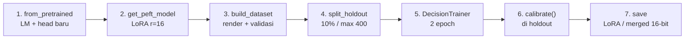

# Proses Fine-Tune Decision Model: Pipeline & Algoritma

> [!abstract] Definisi
> Fine-tune decision model ala Unsloth mengubah LLM generatif menjadi **model keputusan System One**: backbone LLM dibekukan/di-LoRA, sebuah **Clef head** (joint schema head) dipasang di atas `last_hidden_state`, dan seluruh state + semua pertanyaan di-render menjadi **satu prompt tunggal** yang di-skor dalam **satu forward pass** — tanpa generate teks. Objektifnya adalah **cross-entropy berlabel + penalti Brier (kalibrasi) + partial credit ordinal**, dilanjut **kalibrasi temperatur pasca-train** agar confidence = frekuensi benar empiris.

Catatan terkait: [[00-index-rlcd-and-system-one|Hub RLCD]], [[01-rlcd-theory-and-formalism|Teori RLCD]], [[03-typesafe-jev-architecture|Arsitektur Jev]].

---

## 1. Intuisi: apa yang sebenarnya "dilatih"?

Tiga komponen berubah saat fine-tune (kode: `unsloth/models/decision.py`, `decision_from_lm.py`, `clef.py`):

| # | Komponen | Status saat train | Peran |
|---|----------|-------------------|-------|
| 1 | **Backbone LLM** (Qwen/Llama/Gemma/LFM…) | LoRA (`r=16`, `get_peft_model`) atau frozen (`freeze_backbone`) | Membaca state + skema, menghasilkan representasi |
| 2 | **Clef head** (`JointSchemaHead`, fresh random init via `default_head_config`) | **Selalu trainable, LR sendiri (`head_learning_rate`, default `1e-4`)** | Routing bukti → skor tiap opsi tiap pertanyaan |
| 3 | **Temperatur kalibrasi** (`head_temperature` + per-type) | Di-fit **setelah** train via `calibrate()` (LBFGS), bukan via gradient | Menskalakan logit agar probabilitas jujur |

> [!quote] Unsloth — cara kerja decision model
> "Unsloth puts your input in one prompt, followed by every question and its options. The LLM reads it once. A small head, the same design as Cloudflare's Clef, looks at the LLM's output over each question and option and scores every option, deciding all the questions together. It never writes text, so it doesn't spend memory on the LLM's word predictions."
> — [Train your own Decision Model with Unsloth](https://unsloth.ai/docs/basics/train-your-own-decision-model-with-unsloth)

---

## 2. Pipeline ujung-ke-ujung (7 tahap)



### Tahap 1–2 — Load & LoRA

```python
from unsloth import FastDecisionModel

model, tokenizer = FastDecisionModel.from_pretrained(
    model_name = "unsloth/Qwen3.5-4B",
    max_seq_length = 2048,
    load_in_4bit = True,          # QLoRA: ~4x hemat VRAM
)
model = FastDecisionModel.get_peft_model(
    model,
    r = 16, lora_alpha = 16, lora_dropout = 0,
    use_gradient_checkpointing = "unsloth",
    random_state = 3407,
)
```

`from_pretrained` memanggil `load_lm_as_decision_model(..., decision_head="clef")`: backbone standar + head baru berdimensi `hidden_size` model. Artinya **head bersifat agnostik arsitektur** — alasan LFM-2.5-350M (hybrid conv-attention) secara prinsip bisa dipasang head yang sama, dengan catatan `target_modules` LoRA mengikuti penamaan layer LFM (`q/k/v/out/in_proj, w1/w2/w3`, bukan `q/k/v/o/gate/up/down`).

### Tahap 3 — `build_dataset`: render state + pertanyaan jadi satu sekuens

Setiap baris dataset di-render oleh `encode_record` (referensi Cloudflare, divendor utuh di `unsloth/_vendor/clef/joint_schema_model.py`):

```
<|im_start|>system
Read the complete state and schema. Decide every field jointly. ...
<|im_start|>user
STATE:
<state, JSON canonical sort_keys atau string>
SCHEMA FIELDS:
FIELD 1
ID: team
TYPE: choice
INSTRUCTION: Which team should handle this?
ALLOWED OPTIONS:
OPTION 1: {"option_id":"billing","description":"invoices, payments, refunds"}
OPTION 2: ...
END FIELD
...
<|im_end|> ... JOINT SCHEMA DECISIONS:
```

Aturan kritis (dari kode, bukan tebakan):

- **State yang dipotong, bukan skema.** `"Over max_seq_length the end of the state is cut, never questions or options."` Jika skema saja sudah melebihi batas → error, bukan diam-diam dipotong.
- Opsi `choice` diurut alfabetis (`sorted(criteria.items())`); `score` terurut indeks `0..L-1`; `noul` selalu pasangan `true`/`false`.
- `build_dataset(rows, tokenizer, model, validate=None)` mengembalikan `(items, report)`; baris tak valid **di-skip dan dilaporkan** (`report['skipped']` dari `report['total']`).

### Tahap 4 — `split_holdout(items, seed=3407, fraction=0.1, max_items=400)`

Memisahkan holdout untuk **kalibrasi + pelaporan akurasi before/after**. Holdout inilah yang dipakai `calibrate()` — jangan campur dengan test akhir (lihat [[03-eval-benchmark-guide|panduan eval]]).

### Tahap 5 — `DecisionTrainer`: loss & optimasi

```python
from unsloth import DecisionTrainer
from transformers import TrainingArguments

trainer = DecisionTrainer(
    model = model, processing_class = tokenizer,
    train_dataset = train_items, eval_dataset = eval_items,
    args = TrainingArguments(
        per_device_train_batch_size = 8,
        gradient_accumulation_steps = 4,
        num_train_epochs = 2,          # data sedikit → 3-4
        learning_rate = 2e-4,          # LR backbone/LoRA
        lr_scheduler_type = "cosine", warmup_steps = 10,
        weight_decay = 0.01,
        bf16 = True, eval_strategy = "epoch",
        logging_steps = 10, output_dir = "outputs",
        report_to = "none", seed = 3407,
    ),
)
trainer.train()
```

**Fungsi loss** (`_decision_loss` — "resep Clef menurut Cloudflare", kutip kode):

```python
# label-smoothed cross entropy + Brier (kalibrasi) + partial credit ordinal (score)
loss = -(smoothed * log_p).sum(-1).mean()
p = log_p.exp()
if brier_weight:
    loss = loss + brier_weight * ((p - target) ** 2 * mask).sum(-1).mean()
if ordinal_weight and ordinal is not None and ordinal.any():
    # expected distance dari level gold, dinormalisasi rentang opsi
    expected = torch.einsum("ri,ij,rj->r", p, distance, target) / span
    loss = loss + ordinal_weight * (expected * ordinal).sum() / ordinal.sum()
```

Parameter opsional `DecisionTrainer`: `head_learning_rate` (default `1e-4`, di-split dari LR backbone di `create_optimizer`), `label_smoothing`, `brier_weight`, `ordinal_weight`, `kl_weight` (KL ke reference head bila ada), `permute_fields`.

**Arsitektur head** (`JointSchemaHead.forward`, matematika per pertanyaan $q$):

$$ \text{logit}_q = \underbrace{s_{\text{prior}}\cdot\langle \hat{\ell}, \hat{a}\rangle}_{\text{prior leksikal dari embedding LM}} + \sigma(g)\cdot\Big(\underbrace{s_{\text{joint}}\cdot\cos(f, o) + \text{MLP}([f;o;f\odot o;|f-o|])}_{\text{joint reasoning}}\Big) $$

dengan $f$ = vektor field (instruksi + ringkasan opsi + vektor global + embedding tipe), $o$ = vektor opsi hasil **evidence routing** (opsi attend ke seluruh sekuens, 2 layer) + **4 decoder layer** atas field. Probabilitas akhir = softmax per pertanyaan. Inilah "parallel sampler": $M$ pertanyaan dijawab dalam $O(1)$ pass terhadap panjang output.

### Tahap 6–7 — Kalibrasi & simpan

```python
metrics = FastDecisionModel.calibrate(model, tokenizer, eval_items)
print(metrics)  # held-out accuracy, calibration error (ece), loss

model.save_pretrained("qwen-decisions")          # LoRA adapters + head
model.save_pretrained_merged("qwen-decisions-merged")  # full 16-bit
```

Detail `calibrate()`: fit **satu temperatur global head** (LBFGS pada log-T, `line_search="strong_wolfe"`, range `[0.05, 20.0]`) + **temperatur relatif per tipe** (`noul/choice/score`, min 10 sampel per tipe, jika tidak fallback). Target fit memakai **hard label** (one-hot gold), bukan distribusi lunak — karena confidence dibaca sebagai "peluang jawaban benar"; target lunak membuat model underconfident (0.61 vs akurasi 0.78 pada typed-decisions).

---

## 3. Setting yang direkomendasikan (dari Unsloth)

- Mulai: **4-bit LoRA rank 16, LR `2e-4`**; head LR default `1e-4` (ubah via `head_learning_rate`).
- **2 epoch** pada typed-decisions; data lebih sedikit → 3–4 epoch.
- Smoke test: `max_steps = 60` (Qwen3.5-4B mencapai 76% dalam 10 mnt di L4).
- OOM → bagi dua batch, gandakan akumulasi gradien.
- `max_seq_length` = input terpanjang saat train; prediksi membaca s.d. **16.384 token**.

Biaya terukur (1 epoch, LoRA r=64, dataset campuran 12 sumber):

| Model | Holdout acc | VRAM | Waktu |
|---|---|---|---|
| Qwen3.5-0.8B | 78% | 4 GB | 42 mnt |
| Qwen3.5-2B | 81% | 8 GB | 40 mnt |
| Llama 3.2 3B | 79% | 4.1 GB | 30 mnt |
| Gemma 4 E4B | 77% | 14.4 GB | 49 mnt |
| Laya (fine-tune lanjut) | 77% | 2.5 GB | 10 mnt |

> [!quote] Klaim cakupan model
> "All models work as well — and you can also further fine-tune Decision models like Laya / Clef… Other LLMs that Unsloth can fine-tune should work the same way."
> — [Train your own Decision Model with Unsloth](https://unsloth.ai/docs/basics/train-your-own-decision-model-with-unsloth)

Batasan kode/dok yang perlu dicatat: train `TRAIN_MAX_LEN=1024` (Konteks Laya: multilingual 1024, english/typed 512); serve/predict s.d. 16384; holdout max 400; opsi > ~20 deskriptif per choice mulai terpotong budget token (maks 255 opsi/choice, 10 level/score, 64 pertanyaan/request).
