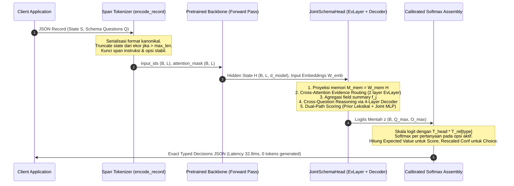

# Arsitektur System One: From-Scratch vs Fine-Tuned, Metode Training, Data & Pipeline

> [!abstract] Definisi
> **System One Model** adalah arsitektur model AI non-autoregresif yang mengevaluasi representasi state kontekstual ($S$) dan skema pertanyaan terstruktur ($Q$) dalam **satu forward pass tunggal ($O(1)$ decoding steps)** untuk menghasilkan vektor probabilitas terkalibrasi secara matematis pada primitif diskret (`Choice`, `Score`, `Noul`) tanpa menghasilkan token teks generatif. Paradigma ini diimplementasikan melalui dua cabang arsitektur:
> 1. **From-Scratch (Bidirectional Encoders)**: Membangun representasi dwiarah penuh (ModernBERT 421M, mmBERT 322M) dengan *option-marker scoring head* atau *linear boundary prediction* (GLiNER 2.5).
> 2. **Fine-Tuned LLMs/SLMs**: Memasang *JointSchemaHead* (desain Cloudflare Clef / Unsloth `FastDecisionModel`) di atas backbone decoder/hybrid (Qwen2.5/3.5, Liquid AI LFM2.5-350M) via LoRA.
> Pelatihan model System One memadukan **multi-objective proper loss** (label-smoothed CE, Brier calibration penalty, ordinal distance loss, dan KL soft-consensus) dengan kalibrasi temperatur pasca-latih via L-BFGS, serta **RLCD policy optimization** dua tahap (*calibrate, then reinforce*) untuk memitigasi *System-One collapse* dan *policy-gradient noise* ([Gao & Wang, arXiv:2609.38850](https://arxiv.org/abs/2609.38850)).

Catatan terkait: [[00-index-rlcd-and-system-one|Hub RLCD]], [[01-rlcd-theory-and-formalism|Teori RLCD]], [[02-rlcd-vs-rlhf-comparison|RLCD vs RLHF]], [[03-typesafe-jev-architecture|Arsitektur Jev]], [[04-laya-decision-engine|Laya Decision Engine]], [[05-gliner-2-5-boundary-architecture|GLiNER 2.5]], [[06-parallel-constrained-decoding-implementations|Parallel Decoding]], [[07-evaluation-methodology-and-benchmarks|Metodologi Evaluasi]].

---

## 1. Intuisi & Latar Belakang Desain

Dalam arsitektur software terotomatisasi, menggunakan LLM generatif autoregresif (*System Two*) untuk mengambil keputusan perutean data atau klasifikasi terstruktur memunculkan tiga inefisiensi kritis:
1. **Inefisiensi Inferensi Autoregresif ($O(T)$ Latency)**: Menghasilkan format JSON token-demi-token memakan $150\text{--}500$ iterasi decoding ($1.500\text{--}4.000\text{ ms}$), mengonsumsi bandwidth memori kuadratik pada KV-cache hanya untuk mencetak sintaks tanda kurung dan spasi.
2. **Halusinasi Sintaks & Tipe**: Generator teks bebas selalu memiliki probabilitas non-nol untuk melanggar skema (menghasilkan JSON invalid, null field, atau key yang hilang).
3. **Patologi Overconfidence**: Model autoregresif yang diselaraskan dengan [[02-rlcd-vs-rlhf-comparison|RLHF]] atau RLVR belajar menyatakan tebakan yang salah dengan nada yang sangat yakin, sehingga metrik confidence-nya tidak dapat dijadikan dasar pendelegasian otomatisasi kritis.

System One mengubah seluruh inferensi menjadi masalah **joint evidence routing**: model membaca dokumen konteks dan skema pertanyaan secara bersamaan satu kali, mengevaluasi seluruh kandidat opsi secara simultan, dan menghasilkan probabilitas yang mencerminkan frekuensi kebenaran empiris sebenarnya.

```
                           +--------------------------------------------------------------+
                           |                     Input Context (State S)                  |
                           |               + Multi-Question Schema (Questions Q)          |
                           +--------------------------------------------------------------+
                                                          |
                                                          v
                                        +------------------------------------+
                                        |    Single Forward Pass Feature     |
                                        |  Extraction (Encoder / SLM LoRA)   |
                                        +------------------------------------+
                                                          |
                                 +------------------------+------------------------+
                                 |                                                 |
                                 v                                                 v
               [ Pure Bidirectional From Scratch ]                [ Fine-Tuned LLM/SLM Backbone ]
                 (ModernBERT-421M / mmBERT-322M)                   (Qwen2.5 / Liquid LFM2.5-350M)
                                 |                                                 |
                                 v                                                 v
               +-----------------------------------+             +-----------------------------------+
               |    Option-Marker Scoring Head     |             |         JointSchemaHead           |
               | • Dedicated [MASK] per candidate  |             | • EvLayer Cross-Attention Memory  |
               | • Boundary Scoring O(L)           |             | • 4-Layer Transformer Decoder     |
               | • Sub-0.5ms Unicode Script Router |             | • Dual-Path: Prior + Joint MLP    |
               +-----------------------------------+             +-----------------------------------+
                                 |                                                 |
                                 +------------------------+------------------------+
                                                          |
                                                          v
                                        +------------------------------------+
                                        | Multi-Objective Loss + L-BFGS Post |
                                        |  Calibration (T_head, T_rel[type]) |
                                        +------------------------------------+
                                                          |
                                                          v
                                        +------------------------------------+
                                        |      Exact JSON Decision Output    |
                                        |  (Choice, Score, Noul in 32.8ms)   |
                                        |  0 tokens generated, 0% hallucination|
                                        +------------------------------------+
```

---

## 2. Taksonomi Arsitektur: From-Scratch vs. Fine-Tuned LLMs/SLMs

### 2.1 Arsitektur From-Scratch: Pure Bidirectional Encoders (Laya & GLiNER 2.5)

Pendekatan *from-scratch* memanfaatkan encoder dwiarah murni di mana seluruh token dapat saling memperhatikan tanpa kausalitas mask kiri-ke-kanan.

#### 1. Backbone Encoders
- **ModernBERT-large** (421M parameter, 395M encoder body, 8k sequence context, FlashAttention-2, RoPE native): Digunakan sebagai inti model mono-skrip Inggris (`convaiinnovations/laya` dan `laya-typed-decisions`).
- **mmBERT-base** (322M parameter, 22 layer, 256k vocabulary): Digunakan pada varian multilingual (`laya-multilingual`) yang mencakup 100+ bahasa.

> [!quote] Convai Innovations (2026)
> "Laya evaluates typed questions over any state in a single forward pass — 33 ms for one question, 7.2 ms/question batched, measured on a T4. No text generation, so nothing to parse and nothing to hallucinate."
> — [Convai Laya GitHub Repository](https://github.com/NandhaKishorM/laya)

#### 2. Option-Marker Scoring Head
Alih-alih memprediksi token sekuensial, urutan input disisipkan token penanda opsi khusus (`[MASK]` atau span markers) untuk setiap pilihan jawaban:
$$\mathbf{H} = \text{Encoder}(S, q_1, \dots, q_M) \in \mathbb{R}^{L_{\text{total}} \times d_{\text{model}}}$$
Untuk setiap opsi ke-$k$ pada pertanyaan $j$, representasi hidden state pada token penanda $\mathbf{h}_{\text{marker}(j, k)}$ diproyeksikan menjadi logit skalar:
$$z_{j, k} = \mathbf{W}_{\text{head}} \mathbf{h}_{\text{marker}(j, k)} + b_{\text{head}} \in \mathbb{R}$$
Distribusi probabilitas diperoleh melalui satu kali softmax termal:
$$p_{j, k} = \frac{\exp(z_{j, k} / T)}{\sum_{m=1}^{K_j} \exp(z_{j, m} / T)}$$

#### 3. Pencegahan Script Collapse via Unicode Script Router
Bidirectional encoder yang dilatih murni pada teks alfabet Latin mengalami **Script Collapse** ketika menerima alfabet non-Latin:

> [!quote] Elena Varga (LavX News, 2026)
> "On Khmer text, the English checkpoint achieved 0% accuracy while reporting 95.2% confidence. Armenian text yielded 5% accuracy at 88.5% confidence. The confidence signal provides no warning when the model cannot read the input."
> — [LavX News: Laya offers open-source alternative](https://news.lavx.hu/article/laya-offers-open-source-alternative-to-proprietary-ai-decision-engines-hitting-32ms-latency)

Laya memitigasi kegagalan ini dengan menempatkan router Unicode sub-milidetik ($<0.5\text{ ms}$) sebelum forward pass:
$$\text{Target Checkpoint} = \begin{cases} 
\texttt{laya-multilingual}, & \text{jika terdeteksi 22 skrip non-Latin atau stopword non-Inggris} \\
\texttt{laya (English)}, & \text{jika seluruh teks menggunakan skrip Latin & Inggris}
\end{cases}$$
Kedua model di-preload di VRAM GPU komoditas (konsumsi total ~2.4 GB), sehingga peralihan terjadi tanpa overhead swap memori.

#### 4. Boundary Prediction Architecture (Fastino GLiNER 2.5)
Pada tugas ekstraksi dan klasifikasi informasi terstruktur, GLiNER 2.5 mengeliminasi kelemahan *span enumeration* ($O(L \cdot W)$ pasangan kandidat) dengan memprediksi batas entitas secara langsung:
- **Start Boundary**: $P_{\text{start}}(i \mid q_k) = \sigma\left( \mathbf{W}_s [h_i \odot e_k] + b_s \right)$
- **End Boundary**: $P_{\text{end}}(j \mid q_k) = \sigma\left( \mathbf{W}_e [h_j \odot e_k] + b_e \right)$
- **Inside Token**: $P_{\text{inside}}(t \mid q_k) = \sigma\left( \mathbf{W}_m [h_t \odot e_k] + b_m \right), \quad i \le t \le j$
Proses ini menurunkan kompleksitas memori dan komputasi menjadi linear $O(L)$, memungkinkan pemrosesan dokumen hingga 4.096 token tanpa chunking.

---

### 2.2 Arsitektur Hasil Fine-Tuned LLMs/SLMs: JointSchemaHead (Clef / FastDecisionModel)

Pendekatan fine-tune mengadaptasi model autoregresif atau hibrida yang telah memiliki pemahaman semantik mendalam melalui SFT/pretraining (misalnya `Qwen2.5-0.5B/1.5B/3B` atau `LiquidAI/LFM2.5-350M`).

> [!quote] Unsloth Documentation (2026)
> "Unsloth puts your input in one prompt, followed by every question and its options. The LLM reads it once. A small head, the same design as Cloudflare's Clef, looks at the LLM's output over each question and option and scores every option, deciding all the questions together. It never writes text, so it doesn't spend memory on the LLM's word predictions."
> — [Train your own Decision Model with Unsloth](https://unsloth.ai/docs/basics/train-your-own-decision-model-with-unsloth)

#### Anatomi & Modul `JointSchemaHead`
Diimplementasikan pada `head.py` dan `unsloth.models.decision` (~6M parameter pada $\text{width} = 256$):
1. **Normalisasi & Proyeksi Memori**:
   $$\mathbf{H} = \text{LayerNorm}(H_{\text{backbone}}) \in \mathbb{R}^{B \times L \times d_{\text{model}}}$$
   $$\mathbf{M}_{\text{mem}} = \mathbf{W}_{\text{mem}} \mathbf{H} \in \mathbb{R}^{B \times L \times w}$$
2. **Ekstraksi Vektor Span**:
   - Vektor instruksi pertanyaan: $\mathbf{q}_v^{(j)} = \frac{1}{e_j - s_j} \sum_{t=s_j}^{e_j - 1} \mathbf{H}_{b, t}$
   - Vektor konteks opsi: $\mathbf{c}_o^{(j, k)} = \frac{1}{e_{jk} - s_{jk}} \sum_{t=s_{jk}}^{e_{jk} - 1} \mathbf{H}_{b, t}$
   - Rata-rata embedding leksikal: $\boldsymbol{\ell}_o^{(j, k)} = \frac{1}{e_{jk} - s_{jk}} \sum_{t=s_{jk}}^{e_{jk} - 1} \mathbf{W}_{\text{emb}}[X_{b, t}]$
   - Vektor ringkasan global (token terakhir): $\mathbf{g}_{\text{glo}} = \mathbf{H}_{b, L-1}$
3. **Evidence Routing via Cross-Attention (`EvLayer`)**:
   Query awal opsi dibentuk dari gabungan proyeksi:
   $$\mathbf{o}_{\text{init}}^{(j, k)} = \mathbf{W}_{\text{cp}} \mathbf{c}_o^{(j, k)} + \mathbf{W}_{\text{lp}} \boldsymbol{\ell}_o^{(j, k)} + \mathbf{W}_{\text{qp}} \mathbf{q}_v^{(j)}$$
   Dua lapis `EvLayer` melakukan multi-head cross-attention atas memori konteks $\mathbf{M}_{\text{mem}}$:
   $$\mathbf{O}_{\text{routed}} = \text{EvLayer}_2\left(\text{EvLayer}_1(\mathbf{o}_{\text{init}}, \mathbf{M}_{\text{mem}}), \mathbf{M}_{\text{mem}}\right)$$
4. **Agregasi Field & Reasoning Lintas-Pertanyaan (Transformer Decoder)**:
   Opsi yang telah dirutekan diagregasi dengan bobot perhatian terhadap instruksi pertanyaan, digabungkan dengan tipe primitif $\mathbf{E}_{\text{type}}[\text{type}_j]$, lalu diproses melalui 4 layer Transformer Decoder untuk menghasilkan representasi field $\mathbf{f}_j$.
5. **Dual-Path Scoring (Prior Leksikal + Joint Reasoning)**:
   - **Jalur Prior**: Mengukur keselarasan leksikal token opsi terhadap pertanyaan dan ringkasan global:
     $$\text{Score}_{\text{prior}}(j, k) = e^{\min(\theta_{\text{prior}}, \ln 100)} \cdot \left( \frac{\boldsymbol{\ell}_o^{(j, k)}}{\|\boldsymbol{\ell}_o^{(j, k)}\|_2} \cdot \frac{\mathbf{q}_v^{(j)} + \mathbf{g}_{\text{glo}}}{\|\mathbf{q}_v^{(j)} + \mathbf{g}_{\text{glo}}\|_2} \right)$$
   - **Jalur Joint**: Menghitung interaksi non-linear antara representasi field $\mathbf{f}_j$ dan representasi opsi $\mathbf{o}_k$:
     $$\mathbf{v}_{\text{interact}} = [\mathbf{f}_j \,;\, \mathbf{o}_k \,;\, (\mathbf{f}_j \odot \mathbf{o}_k) \,;\, |\mathbf{f}_j - \mathbf{o}_k|] \in \mathbb{R}^{4w}$$
     $$\text{Score}_{\text{joint}}(j, k) = e^{\min(\theta_{\text{joint}}, \ln 100)} \cdot \cos(\mathbf{f}_j, \mathbf{o}_k) + \text{MLP}_{\text{res}}(\mathbf{v}_{\text{interact}})$$
   - **Logit Akhir**:
     $$z_{j, k} = \text{Score}_{\text{prior}}(j, k) + \sigma(\theta_{\text{gate}}) \cdot \text{Score}_{\text{joint}}(j, k)$$

---

### 2.3 Matriks Perbandingan: From-Scratch vs Fine-Tuned LLM/SLM

| Dimensi | From-Scratch (ModernBERT / Laya) | Fine-Tuned SLM (Liquid LFM2.5-350M Clef) | Fine-Tuned LLM (Qwen2.5-1.5B/3B Clef) | Autoregressive JSON Mode (LLaMA-3-8B) |
| :--- | :--- | :--- | :--- | :--- |
| **Arsitektur Backbone** | Bidirectional Encoder (421M / 322M) | Hybrid Conv-Attention (350M) | Causal Decoder Transformer (1.5B–3B) | Causal Decoder Transformer (8B) |
| **Mekanisme Head** | Dedicated Option Markers (`[MASK]`) | JointSchemaHead (EvLayer + Decoder) | JointSchemaHead (EvLayer + Decoder) | Autoregressive LM Head |
| **Forward Passes** | **1 pass** | **1 pass** | **1 pass** | $150\text{--}500$ sequential passes |
| **Output Tokens Generated** | **0 tokens** | **0 tokens** | **0 tokens** | $150\text{--}500$ tokens |
| **Latency p50 (Single Query)** | **$32.8\text{ ms}$** (Tesla T4) | **$43.0\text{ ms}$** (Tesla T4 / Apple M4) | **$68.0\text{ ms}$** (A100 / RTX 4090) | $1.800\text{--}3.500\text{ ms}$ |
| **Batched Latency (10 Pertanyaan)**| **$7.2\text{ ms}$ / query** | **$12.5\text{ ms}$ / query** | **$18.0\text{ ms}$ / query** | $12.000\text{--}25.000\text{ ms}$ |
| **Kebutuhan VRAM GPU** | **$1.2\text{ GB}$** | **$1.8\text{ GB}$** (FP16) / $0.9\text{ GB}$ (4-bit) | **$3.5\text{ GB}$** (QLoRA) | $16.0\text{--}24.0\text{ GB}$ |
| **Dukungan Kardinalitas ($K > 50$)**| Terbatas ($\text{head\_max\_len}$ bottleneck) | Sangat Baik (dinamis via span tracking) | Sangat Baik (dinamis via span tracking) | Buruk (rentan repetisi sintaks) |
| **Jaminan Skema Sintaks** | **100% (By Construction)** | **100% (By Construction)** | **100% (By Construction)** | $92.0\%\text{--}98.0\%$ (Sering break) |
| **Biaya Marginal Token Output** | **$0.00 (Gratis)** | **$0.00 (Gratis)** | **$0.00 (Gratis)** | $\$10.00\text{--}\$15.00$ / 1M token |

---

## 3. Metode Training & Optimasi Matematis

### 3.1 Loss Functions Multi-Objektif

Pelatihan supervised decision model menggunakan fungsi rugi multi-tugas yang menggabungkan diskriminasi label, penalti kalibrasi kuadratik, bobot ordinal, dan konsensus distribusi:

$$\mathcal{L}_{\text{total}} = \mathcal{L}_{\text{CE}}^{\text{smoothed}} + \lambda_{\text{brier}} \mathcal{L}_{\text{Brier}} + \lambda_{\text{ord}} \mathcal{L}_{\text{ordinal}} + \lambda_{\text{KL}} \mathcal{L}_{\text{KL}}$$

#### 1. Label-Smoothed Cross-Entropy ($\mathcal{L}_{\text{CE}}^{\text{smoothed}}$)
Mencegah model menghasilkan logit ekstrem yang merusak kalibrasi:
$$\tilde{y}_{bqk} = (1 - \epsilon_{\text{ls}}) y_{bqk} + \epsilon_{\text{ls}} \frac{\mathbf{M}_{bqk}}{\sum_{j} \mathbf{M}_{bqj}}$$
$$\mathcal{L}_{\text{CE}}^{\text{smoothed}} = - \frac{1}{\sum_{b, q} \mathbf{1}_{[\exists k : \mathbf{M}_{bqk}=1]}} \sum_{b, q} \sum_{k} \tilde{y}_{bqk} \log p_{bqk}$$
di mana $\mathbf{M}_{bqk} \in \{0, 1\}$ adalah mask validitas opsi (opsi yang aktif untuk pertanyaan tersebut).

#### 2. Strictly Proper Brier Score Penalty ($\mathcal{L}_{\text{Brier}}$)
Aturan penilaian kuadratik strictly proper yang menghukum deviasi probabilitas terhadap label ground truth:
$$\mathcal{L}_{\text{Brier}} = \frac{1}{\sum_{b, q} \mathbf{1}_{[\exists k : \mathbf{M}_{bqk}=1]}} \sum_{b, q} \sum_{k} (p_{bqk} - y_{bqk})^2 \mathbf{M}_{bqk}$$
Berdasarkan **Dekomposisi Murphy (1973)**, nilai harapan Brier Score terbagi menjadi tiga komponen ortogonal:
$$\mathbb{E}[\text{BS}] = \underbrace{\sum_{m=1}^M \frac{|B_m|}{N} (\text{conf}(B_m) - \text{acc}(B_m))^2}_{\text{Reliability (Calibration Deficit)}} - \underbrace{\sum_{m=1}^M \frac{|B_m|}{N} (\text{acc}(B_m) - \bar{y})^2}_{\text{Resolution}} + \underbrace{\bar{y}(1 - \bar{y})}_{\text{Uncertainty}}$$
Meminimalkan $\mathcal{L}_{\text{Brier}}$ secara matematis memaksa $\text{Reliability} \to 0$ (kalibrasi sempurna) sambil memaksimalkan ketajaman diskriminasi ($\text{Resolution}$).

#### 3. Ordinal Distance Loss ($\mathcal{L}_{\text{ordinal}}$) untuk Primitif `Score`
Pada pertanyaan bertipe peringkat ordinal ($L$ tingkatan dengan level $0 \dots L-1$), kesalahan memprediksi level 0 ketika jawaban aslinya level 1 harus dihukum jauh lebih ringan daripada meleset ke level 4. Didefinisikan matriks jarak $\mathbf{D}_{ij} = |i - j|$:
$$\mathbb{E}[\text{dist}]_{bq} = \frac{1}{L - 1} \sum_{i=0}^{L-1} \sum_{j=0}^{L-1} p_{bqi} |i - j| y_{bqj} = \frac{1}{L - 1} \mathbf{p}_{bq}^\top \mathbf{D} \mathbf{y}_{bq}$$
$$\mathcal{L}_{\text{ordinal}} = \frac{1}{\sum_{b, q} \mathbf{1}_{[q \in \text{ordinal}]}} \sum_{b, q : q \in \text{ordinal}} \mathbb{E}[\text{dist}]_{bq}$$

#### 4. Kullback-Leibler Divergence untuk Soft Consensus Labels ($\mathcal{L}_{\text{KL}}$)
Ketika data latih memiliki distribusi probabilitas konsensus rater manusia $q_{\text{consensus}} \in \Delta^{K-1}$:
$$\mathcal{L}_{\text{KL}} = \frac{1}{N} \sum_{i=1}^N \sum_{k=1}^K q_{\text{consensus}, ik} \log\left( \frac{q_{\text{consensus}, ik}}{p_{ik}} \right)$$

---

### 3.2 Optimasi AdamW dengan Decoupled Learning Rates

Head keputusan diinisialisasi secara acak dan membutuhkan laju konvergensi yang berbeda dengan backbone yang sudah dipra-latih:
- **Laju Belajar Head**: $\eta_{\text{head}} = 1\times 10^{-4}$ (penyesuaian cepat representasi routing).
- **Laju Belajar Backbone LoRA**: $\eta_{\text{backbone}} = 2\times 10^{-4}$ (adaptasi fitur representasi).
- **Weight Decay**: $\lambda_{\text{wd}} = 0.01$ untuk matriks bobot linear 2D, $\lambda_{\text{wd}} = 0.0$ untuk bias dan parameter LayerNorm.
- **Scheduler**: Cosine annealing dengan linear warmup $10\%$ durasi total.

---

### 3.3 Teori RLCD & Temuan OpenJev-RLCD (Gao & Wang, arXiv:2609.38850)

Penelitian independen oleh Zhimin Gao & Pichao Wang (September 2026) mengungkapkan dinamika matematis mendalam mengenai pelatihan RLCD pada model keputusan:

#### 1. Dekomposisi Variansi (Proposition 1)
Misalkan model menghasilkan distribusi jawaban $u(r)$ setelah mengevaluasi penalaran/state $r$. Untuk Brier score $J(u, q) = 2 u^\top q - \|u\|^2$:
$$J(p, q) = \mathbb{E}_r [J(u(r), q)] + \mathbb{E}_r \|u(r) - p\|^2$$
di mana $p = \mathbb{E}_r u(r)$.
- **Implikasi Kritis**: Menilai campuran beberapa sampel (*scoring the mixture of samples*) memberikan bonus arbitrer $\mathbb{E}_r \|u(r) - p\|^2$ bagi sampel yang saling bertentangan (*disagreeing rationales*), tanpa memedulikan apakah ketidaksepakatan tersebut valid.
- **Hubungan dengan RLVR (Corollary 1)**: RLVR pada dasarnya adalah objektif campuran di atas tanpa suku keberagaman ($\lambda = 0$). Suku variansi tersebut merupakan Gini impurity dari $p$. Akibatnya, RLVR secara inheren memicu **patologi overconfidence**.

#### 2. The System-One Collapse
Jika model dilatih secara naif menggunakan objektif *per-rationale* tanpa penalti KL, model menemukan jalan pintas: belajar melakukan *hedging* probabilitas tanpa penalaran jauh lebih cepat daripada belajar bernalar.
Dalam $\sim 100$ langkah training pada MMLU-Pro, seluruh penalar menciut menjadi string kosong: **model secara spontan berubah menjadi model System One murni (direct scorer)**.

#### 3. Resep Dua Tahap: Calibrate, then Reinforce
Ketika penalaran komputasional dibutuhkan, Gao & Wang mengusulkan resep dua tahap (Algorithm 1):
- **Tahap 1 (Calibrate the Decision)**: Latih *readout head* menggunakan strictly proper scoring rule secara pathwise (gradien deterministik):
  $$\mathcal{L}_{\text{stage1}} = - \frac{1}{M} \sum_{i=1}^M J(u_i, Y)$$
- **Tahap 2 (Reinforce the Reasoning)**: Perkuat penalaran dengan reward proper score yang sama, bobot skor-fungsi yang diperkecil ($c = 0.3$), dan jangkar KL ($\beta = 0.04$) ke model tahap 1:
  $$A_i = R_i - \beta \log \frac{\pi_\theta(r_i)}{\pi_{\theta_1}(r_i)} - \text{baseline}_{\text{leave-one-out}}$$
  $$\mathcal{L}_{\text{stage2}} = - \frac{1}{M} \sum_{i=1}^M R_i - c \sum_{i=1}^M \text{sg}(A_i) \log \pi_\theta(r_i \mid x)$$

#### 4. Batas Ketidakpastian Aleatorik (The Aleatoric Ceiling)
Ketika ketidakpastian berasal dari perbedaan pendapat anotator manusia (seperti pada [[train_decision_models/06-soft-label-dataset-candidates|ChaosNLI]]):
- RLCD **secara matematis terbukti tidak dapat melampaui Cross-Entropy terawasi** pada label yang sama (JSD manusia $0.075$ vs $0.074$).
- Objektif per-rationale secara otomatis mematikan proses penalaran. Untuk ketidakpastian aleatorik, **model System One direct scorer adalah pilihan arsitektur optimal**.

---

### 3.4 Kalibrasi Pasca-Pelatihan (Post-Hoc Calibration via L-BFGS)

Meskipun model telah dilatih dengan Brier penalty, logit mentah tetap mengalami sedikit pergeseran temperatur. Kalibrasi temperatur pasca-latih dilakukan di atas holdout validation set ($N \le 400$ item) dengan meminimalkan Negative Log-Likelihood (NLL) menggunakan algoritma L-BFGS:

$$\min_{T} \mathcal{L}_{\text{NLL}}(T) = - \frac{1}{N} \sum_{i=1}^N \log \left( \frac{\exp(z_{i, y_i^*} / T)}{\sum_{k=1}^K \exp(z_{ik} / T)} \right)$$

#### Parameter & Tata Cara Kalibrasi
1. Optimasi dilakukan atas parameter $\ln T$ menggunakan `torch.optim.LBFGS([log_t], lr=0.1, max_iter=50)`.
2. Nilai temperatur dibatasi ketat: $T \in [0.05, 20.0]$.
3. **Hierarki Dua Tingkat**:
   - Skalar global $T_{\text{head}}$ di-fit untuk seluruh head.
   - Skalar relatif per-primitif $T_{\text{rel}} = [T_{\text{noul}}, T_{\text{choice}}, T_{\text{score}}]$ di-fit terpisah (khusus untuk kelompok tipe dengan sampel $\ge 10$).
4. **Aturan Ground Truth**: Kalibrasi temperatur **wajib di-fit pada label keras (one-hot)**, bukan label lunak, agar nilai confidence mencerminkan akurasi empiris sebenarnya.

---

## 4. Data Pipeline & Mixture Strategy

### 4.1 Format Standar: State-Questions-Gold

Setiap sampel data direpresentasikan dalam tiga komponen kanonikal:

```json
{
  "state": {
    "customer_id": "cust_9921",
    "message": "I was charged twice on invoice #9012. Please refund the duplicate charge immediately.",
    "trace_summary": {"steps": 4, "violations": 0}
  },
  "questions": {
    "department": {
      "type": "choice",
      "instructions": "Which department must handle this customer request?",
      "criteria": {
        "billing": "Invoice disputes, duplicate charges, payment failures",
        "tech_support": "System bugs, login issues, crashes",
        "sales": "Upgrades, demos, contract renewals"
      }
    },
    "urgent": {
      "type": "noul",
      "instructions": "Does this ticket require immediate same-day escalation?"
    },
    "risk_level": {
      "type": "score",
      "instructions": "Financial churn risk assessment.",
      "criteria": ["Minimal risk", "Low risk", "Moderate risk", "High churn risk", "Severe escalation"]
    }
  },
  "gold": {
    "department": "billing",
    "urgent": true,
    "risk_level": 3
  }
}
```

### 4.2 Repositori Dataset Utama

| Dataset | Pengenal Hugging Face & Lisensi | Primitif Keputusan | Metadata Konsensus Lunak |
| :--- | :--- | :--- | :--- |
| **typed-decisions** | `LocalLLaMA/typed-decisions`<br>(Apache-2.0, ~1.6k baris) | 5 pertanyaan/baris: `action` (choice), `needs_review` (noul), `outcome` (choice), `risk` (score), `urgency` (score) | Distribusi konsensus lengkap (`probabilities`), metrik persetujuan rater (`total_variation`, `argmax_agree`). |
| **Open-Jev** | `ZefanCai/Open-Jev`<br>(CC0-1.0 Public Domain, 114k+ baris) | 12 subset skala industri (`choice`, `score`, `noul`) | Soft targets bawaan (misal `[1, 0, 0]`, `[0, 0.5, 0.5]`), partisi resmi `train`, `calibration`, `validation`, `test`, `ood`. |
| **ChaosNLI** | `earino/chaosnli`<br>(CC-BY-NC-4.0, 4.645 baris) | NLI `choice` (entailment, neutral, contradiction) | 100 anotator manusia per sampel menghasilkan vektor sebaran `label_dist` murni. |
| **LeWiDi-2025** | `tasksource/lewidi`<br>(43.168 baris, 7 task) | `hs_brexit` (noul), `conv_abuse` (noul), `csc` (choice/score) | Vektor probabilitas label lunak merefleksikan divergensi persepsi manusia. |
| **BANKING77** | `legacy-datasets/banking77`<br>(CC-BY-4.0, 13.083 baris) | 77-class intent `choice` | Evaluasi kardinalitas tinggi untuk klasifikasi perutean perbankan. |
| **CLINC150** | `clinc/clinc_oos`<br>(plus config, 23.700 baris) | 151-class intent `choice` (150 in-domain + `oos`) | Pengujian deteksi out-of-scope dan transfer domain. |

### 4.3 Resep Campuran 13 Sumber (The 13-Source Mixture)
Untuk mencegah model menghafal skema sempit dan memulihkan kemampuan transfer umum, pelatihan mengombinasikan 12 sumber benchmark publik dengan `typed-decisions`:
$$\mathcal{M} = \{\text{ag\_news}, \text{arc}, \text{banking77}, \text{boolq}, \text{clinc150}, \text{commonsense\_qa}, \text{mmlu}, \text{mnli}, \text{prompt\_injections}, \text{snli}, \text{sst5}, \text{wanli}\} \times 1.0 \cup \{\text{typed\_decisions}\} \times 2.0$$

### 4.4 Augmentasi Data & Shingle-13 Decontamination
1. **Option Key Shuffling**: Mengacak urutan opsi pilihan selama training untuk menghilangkan bias posisi (misal kecenderungan memilih opsi A atau key pertama).
2. **Derived Noul Expansion**: Mengonversi pilihan multi-kelas menjadi pertanyaan biner turunan (misal: memvalidasi `is_billing: noul` dari klasifikasi departemen).
3. **Dekontaminasi Shingle-13**: Untuk menjamin validitas pengujian holdout/test, algoritma `Decontaminator` menyaring dan membuang setiap baris training yang memiliki kesamaan 13-kata berurutan (*13-word consecutive shingle match*) dengan data evaluasi.

---

## 5. Flow Inferensi & Siklus Hidup Eksekusi Ujung-ke-Ujung

Berikut adalah alur data sekuensial dari dokumen mentah hingga keluaran keputusan terstruktur:



### Tahap $t_0 \to t_5$ Eksekusi
1. **$t_0$: Serialisasi State & Skema**: State dikonversi ke JSON string kanonikal (`sort_keys=True`). Skema pertanyaan diparsing untuk memvalidasi batasan tipe (`choice`, `score`, `noul`).
2. **$t_1$: Tokenizer Span Tracking (`encode_record`)**:
   $$L_{\text{fixed}} = \text{len}(pre) + \text{len}(schema) + \text{len}(suf)$$
   $$\text{sids} = \text{tok}(\text{render}(state))[: \max(0, \text{max\_len} - L_{\text{fixed}})]$$
   *Aturan Desain*: State dipotong dari ekor jika melebihi panjang maksimum konteks, namun skema pertanyaan dan opsi tidak pernah dipotong. Seluruh offset indeks token span dicatat secara presisi.
3. **$t_2$: Feature Extraction Single Forward Pass**: Backbone model membaca sekuens input dalam **satu kali prefill** tunggal, menghasilkan tensor representasi hidden state $\mathbf{H} \in \mathbb{R}^{B \times L \times d_{\text{model}}}$.
4. **$t_3$: Evidence Routing & Joint Reasoning**:
   - `EvLayer` merutekan bukti kontekstual dari dokumen ke setiap opsi kandidat melalui mekanisme multi-head cross-attention.
   - Transformer Decoder layer menyelaraskan representasi keputusan antar-pertanyaan secara simultan.
5. **$t_4$: Dual-Path Scoring**: Menggabungkan keselarasan leksikal statis (prior) dengan penalaran representasi dinamis (joint) yang dikontrol melalui learned sigmoid gate $\sigma(\theta_{\text{gate}})$.
6. **$t_5$: Output Assembly & Kalibrasi**: Logit diskalakan dengan temperatur optimal $T$, di-softmax per pertanyaan, dan dirangkai menjadi respon terstruktur tanpa kompilasi atau generasi token teks.

---

## 6. Contoh Minimal dalam Kode: PyTorch Self-Check

Implementasi PyTorch mandiri yang mengimplementasikan arsitektur scoring kepala keputusan, penghitungan multi-objective loss, kalibrasi L-BFGS, dan verifikasi self-check:

```python
"""
Minimal Working Example: System One Decision Head Architecture, Loss & L-BFGS Calibration.
Bisa dijalankan langsung: python 08_system_one_minimal.py
"""
import math
import torch
import torch.nn as nn
import torch.nn.functional as F

class MinimalJointDecisionHead(nn.Module):
    """Head keputusan System One dengan Evidence Cross-Attention dan Dual-Path Scoring."""
    def __init__(self, d_model: int = 64, width: int = 32, heads: int = 2):
        super().__init__()
        self.width = width
        self.hn = nn.LayerNorm(d_model)
        self.mem_proj = nn.Linear(d_model, width, bias=False)
        self.q_proj = nn.Linear(d_model, width, bias=False)
        self.opt_proj = nn.Linear(d_model, width, bias=False)
        
        # Evidence routing via cross-attention
        self.attn = nn.MultiheadAttention(width, heads, batch_first=True)
        self.attn_norm_q = nn.LayerNorm(width)
        self.attn_norm_m = nn.LayerNorm(width)
        
        # Dual-path components
        self.prior_scale = nn.Parameter(torch.zeros(()))
        self.joint_scale = nn.Parameter(torch.zeros(()))
        self.gate = nn.Parameter(torch.zeros(()))
        self.mlp_joint = nn.Sequential(
            nn.Linear(width * 4, width),
            nn.GELU(),
            nn.Linear(width, 1)
        )

    def forward(self, H: torch.Tensor, q_span: tuple, opt_spans: list):
        """
        H: (1, L, d_model) - sequence hidden states dari backbone
        q_span: (start, end) token indices dari instruksi pertanyaan
        opt_spans: list of (start, end) token indices untuk tiap opsi
        """
        H_norm = self.hn(H)
        mem = self.mem_proj(H_norm)  # (1, L, width)
        
        # Pool instruksi pertanyaan
        qv = H_norm[:, q_span[0]:q_span[1]].mean(dim=1)  # (1, d_model)
        q_query = self.q_proj(qv).unsqueeze(1)            # (1, 1, width)
        
        # Pool opsi kandidat
        K = len(opt_spans)
        opts_pooled = torch.stack([H_norm[:, s:e].mean(dim=1) for s, e in opt_spans], dim=1) # (1, K, d_model)
        opt_reps = self.opt_proj(opts_pooled)  # (1, K, width)
        
        # 1. Evidence Routing: Opsi melakukan cross-attention ke seluruh memori teks
        opt_routed, _ = self.attn(self.attn_norm_q(opt_reps), self.attn_norm_m(mem), self.attn_norm_m(mem))
        opt_routed = opt_reps + opt_routed  # Residual
        
        # 2. Dual-path scoring
        # Jalur Prior: Cosine similarity sederhana
        q_norm = F.normalize(q_query, dim=-1)
        o_norm = F.normalize(opt_routed, dim=-1)
        prior_sim = (q_norm * o_norm).sum(dim=-1).squeeze(0)  # (K,)
        prior_score = self.prior_scale.clamp(max=math.log(100.0)).exp() * prior_sim
        
        # Jalur Joint: Interaksi non-linear 4-way
        q_exp = q_query.expand(-1, K, -1)
        interact = torch.cat([q_exp, opt_routed, q_exp * opt_routed, (q_exp - opt_routed).abs()], dim=-1)
        joint_score = self.joint_scale.clamp(max=math.log(100.0)).exp() * prior_sim + self.mlp_joint(interact).squeeze(-1).squeeze(0)
        
        # Gated fusion
        g = torch.sigmoid(self.gate)
        logits = prior_score + g * joint_score
        return logits  # (K,)

def multi_objective_decision_loss(logits: torch.Tensor, target_idx: int, q_type: str = "choice",
                                  label_smoothing: float = 0.05, brier_weight: float = 0.2, ordinal_weight: float = 0.1):
    K = logits.size(0)
    probs = F.softmax(logits, dim=-1)
    target_one_hot = torch.zeros(K, device=logits.device)
    target_one_hot[target_idx] = 1.0
    
    # 1. Label-smoothed Cross-Entropy
    smoothed_target = (1.0 - label_smoothing) * target_one_hot + (label_smoothing / K)
    ce_loss = - (smoothed_target * torch.log_softmax(logits, dim=-1)).sum()
    
    # 2. Brier score calibration penalty
    brier_loss = ((probs - target_one_hot) ** 2).sum()
    
    total_loss = ce_loss + brier_weight * brier_loss
    
    # 3. Ordinal distance loss (khusus tipe score)
    if q_type == "score" and K > 1:
        lv = torch.arange(K, device=logits.device, dtype=torch.float32)
        dist_matrix = (lv.unsqueeze(1) - lv.unsqueeze(0)).abs() / (K - 1)
        expected_dist = torch.sum(probs * dist_matrix[:, target_idx])
        total_loss += ordinal_weight * expected_dist
        
    return total_loss

def calibrate_temperature_lbfgs(val_logits_list: list, val_targets: list) -> float:
    """Kalibrasi temperatur pasca-latih via L-BFGS meminimalkan Negative Log-Likelihood."""
    log_t = torch.zeros(1, requires_grad=True)
    optimizer = torch.optim.LBFGS([log_t], lr=0.1, max_iter=50)
    
    Z = [z.detach() for z in val_logits_list]
    Y = torch.tensor(val_targets, dtype=torch.long)
    
    def closure():
        optimizer.zero_grad()
        loss = 0.0
        T = log_t.exp()
        for z, y in zip(Z, Y):
            loss += F.cross_entropy((z / T).unsqueeze(0), y.unsqueeze(0))
        loss /= len(Z)
        loss.backward()
        return loss

    optimizer.step(closure)
    calibrated_T = float(log_t.exp().clamp(0.05, 20.0).item())
    return calibrated_T

# --- Runnable Verification & Assertions ---
if __name__ == "__main__":
    torch.manual_seed(42)
    
    # Mocking Backbone Representation: 1 sequence of 32 tokens, hidden size 64
    seq_len, d_model = 32, 64
    mock_H = torch.randn(1, seq_len, d_model)
    
    # Question span: tokens 0..5, Options: 3 candidates at spans (6..8), (9..12), (13..15)
    q_span = (0, 5)
    opt_spans = [(6, 8), (9, 12), (13, 15)]
    target_class = 1  # Candidate 2 is ground truth
    
    head = MinimalJointDecisionHead(d_model=d_model, width=32, heads=2)
    
    # 1. Forward Pass Check
    raw_logits = head(mock_H, q_span, opt_spans)
    assert raw_logits.shape == (3,), f"Bentuk logit harus (3,), didapat {raw_logits.shape}"
    
    # 2. Loss Computation Check
    loss = multi_objective_decision_loss(raw_logits, target_class, q_type="choice")
    assert loss.item() > 0.0 and not torch.isnan(loss), "Loss harus bernilai positif dan non-NaN"
    
    # 3. Optimization Overfitting Smoke Test
    optimizer = torch.optim.AdamW(head.parameters(), lr=1e-2)
    initial_loss = loss.item()
    for _ in range(40):
        optimizer.zero_grad()
        l = multi_objective_decision_loss(head(mock_H, q_span, opt_spans), target_class, q_type="choice")
        l.backward()
        optimizer.step()
    
    final_loss = multi_objective_decision_loss(head(mock_H, q_span, opt_spans), target_class, q_type="choice").item()
    assert final_loss < initial_loss * 0.3, f"Optimasi gagal: initial={initial_loss:.4f}, final={final_loss:.4f}"
    
    # 4. Temperature Calibration Check
    val_logits = [head(mock_H, q_span, opt_spans).detach(), torch.tensor([0.2, 2.5, 0.1])]
    val_targets = [1, 1]
    fitted_T = calibrate_temperature_lbfgs(val_logits, val_targets)
    assert 0.05 <= fitted_T <= 20.0, f"Temperatur berada di luar rentang wajar: {fitted_T}"
    
    print(f"System One Minimal Test Passed. Initial Loss: {initial_loss:.4f} -> Final Loss: {final_loss:.4f}. Fitted T: {fitted_T:.4f}")
```

---

## 7. Referensi Primer & Hubungan Vault

### Dokumen & Publikasi Primer
1. **Zhimin Gao & Pichao Wang (2026)**: *OpenJev-RLCD: A Working RLCD Implementation*. arXiv preprint [arXiv:2609.38850](https://arxiv.org/abs/2609.38850). Kode: [github.com/ZimmyGao/openjev-rlcd](https://github.com/ZimmyGao/openjev-rlcd).
2. **TypeSafe AI (Diogo Almeida, 2026)**: *Introducing System One Models and Jev*. [Product Documentation & SDK Primer](https://typesafe.ai/blog/introducing-system-one-models-and-jev).
3. **Convai Innovations (NandhaKishorM, 2026)**: *Laya: Open-Source System 1 Decision Engine*. [Hugging Face convaiinnovations/laya](https://huggingface.co/convaiinnovations/laya) dan [GitHub](https://github.com/NandhaKishorM/laya).
4. **Cloudflare & Unsloth AI (2026)**: *Train your own Decision Model with Unsloth*. [Tutorial & API Specs](https://unsloth.ai/docs/basics/train-your-own-decision-model-with-unsloth) dan [Cloudflare/clef](https://huggingface.co/Cloudflare/clef).
5. **Fastino AI (Mary Newhauser & Urchade Zaratiana, 2026)**: *GLiNER 2.5: Span-Free Information Extraction with Boundary Prediction*. [Research Blog](https://fastino.ai/blog/gliner2-5-span-free-information-extraction).
6. **Glenn W. Brier (1950)**: *Verification of forecasts expressed in terms of probability*. Monthly Weather Review, 78(1):1–3.
7. **Allan H. Murphy (1973)**: *A New Vector Partition of the Probability Score*. Monthly Weather Review, 101(7):595–600.
8. **Tilmann Gneiting & Adrian E. Raftery (2007)**: *Strictly proper scoring rules, prediction, and estimation*. Journal of the American Statistical Association, 102(477):359–378.
9. **Kevin Yang et al. (ICLR 2024)**: *RLCD: Reinforcement Learning from Contrastive Distillation for Language Model Alignment*. [arXiv:2307.12950](https://arxiv.org/abs/2307.12950).

### Navigasi Vault Terkait
- **Teori Dasar**: [[01-rlcd-theory-and-formalism|01. Teori Matematika RLCD & Scoring Rules]]
- **Perbandingan Fondasi**: [[02-rlcd-vs-rlhf-comparison|02. Perbandingan Mendalam RLCD vs RLHF & RLVR]]
- **Implementasi Komersial**: [[03-typesafe-jev-architecture|03. Arsitektur TypeSafe Jev & Primitif]]
- **Open-Source Reference**: [[04-laya-decision-engine|04. Laya Decision Engine & ModernBERT]]
- **Ekstraksi Terstruktur**: [[05-gliner-2-5-boundary-architecture|05. Seri GLiNER 2.5 & Boundary Prediction]]
- **Optimasi Latensi**: [[06-parallel-constrained-decoding-implementations|06. Parallel Constrained Decoding]]
- **Evaluasi Kalibrasi**: [[07-evaluation-methodology-and-benchmarks|07. Metodologi Evaluasi, ECE & Coverage]]
- **Panduan Praktis Fine-Tune**: `train_decision_models/00-finetune-process-and-algorithm.md`
- **Format Dataset**: `train_decision_models/01-dataset-format-guide.md`
- **Log Eksperimen Kaggle**: `from_scratch/README.md`
