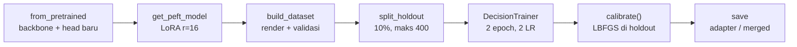

# Alur Training Decision Model Unsloth: dari LLM ke System One

> [!abstract] Definisi
> Training decision model ala Unsloth mengubah LLM generatif menjadi model keputusan
> System One dalam tiga operasi: (1) **memasang Clef head** di atas `last_hidden_state`
> backbone, (2) **fine-tune LoRA + head** dengan loss cross-entropy + Brier + ordinal,
> (3) **kalibrasi temperatur** pasca-train. Output bukan teks melainkan skor tiap opsi
> tiap pertanyaan dalam satu forward pass. Semua mekanisme di bawah diverifikasi dari
> source `unslothai/unsloth` (`models/decision.py`, `models/decision_from_lm.py`,
> `models/clef.py`, `_vendor/clef/joint_schema_model.py`, `models/decision_datasets.py`).

---

## 1. Intuisi: apa yang berubah dari LLM awal

LLM awal (Qwen/Llama/Gemma/LFM) memetakan sekuens ke distribusi kosakata
$\mathcal{V}$ dan generate token demi token. Unsloth memotong rantai itu di dua titik:

| Komponen | LLM generatif | Decision model Unsloth |
|---|---|---|
| Backbone | train penuh / frozen | LoRA (`r=16`) atau frozen; trunk hanya dibaca |
| Output layer | LM head $\to \mathcal{V}$ ($\approx$ 32k–256k) | **Clef head** $\to$ simpleks per pertanyaan $\Delta^{K_m-1}$ |
| Loss | next-token NLL | CE berlabel + Brier + ordinal (+ opsional KL) |
| Decoding | autoregresif, $T$ pass | **satu prefill**, $O(1)$ terhadap output |
| Kalibrasi | tidak ada | temperatur LBFGS pasca-train per tipe |

> [!quote] Unsloth — cara kerja decision model
> "Unsloth puts your input in one prompt, followed by every question and its options.
> The LLM reads it once. A small head, the same design as Cloudflare's Clef, looks at
> the LLM's output over each question and option and scores every option, deciding all
> the questions together. It never writes text, so it doesn't spend memory on the LLM's
> word predictions."
> — [Train your own Decision Model with Unsloth](https://unsloth.ai/docs/basics/train-your-own-decision-model-with-unsloth)

---

## 2. Diagram delta arsitektur

```mermaid
graph TD
    subgraph "SEBELUM: LLM generatif"
        IN1["input_ids (B, T)"] --> BB1["Backbone Transformer<br/>hidden (B, T, d)"]
        BB1 --> LMH["LM Head: Linear(d, V)<br/>logits (B, T, V)"]
        LMH --> GEN["sample autoregresif<br/>T forward pass"]
    end

    subgraph "SESUDAH: Decision model (ClefDecisionModel)"
        IN2["input_ids record<br/>(state + skema)"] --> BB2["Backbone (LoRA/frozen)<br/>hidden (B, T, d)"]
        BB2 --> HN["LayerNorm + proyeksi<br/>memori & query"]
        HN --> EV["Evidence routing<br/>opsi attend ke sekuens"]
        EV --> DC["Decoder atas field<br/>+ prior leksikal"]
        DC --> SC["skor per opsi<br/>softmax per pertanyaan"]
        BB2 -.->|"bobot embedding<br/>(frozen, detach)"| DC
    end
```



Pemasangan dilakukan `load_lm_as_decision_model` (`models/decision_from_lm.py`):
backbone dimuat seperti biasa, lalu `JointSchemaHead(**default_head_config(hidden_size))`
diinisialisasi acak dan digabung menjadi `ClefDecisionModel(backbone, head)` dengan
`decision_config = {layout: "clef", max_len, temperature: [1.0]*3, base_model}`.
Head bersifat agnostik arsitektur: ia hanya membaca $\mathbf{H} \in \mathbb{R}^{T \times d}$
dan bobot embedding output — alasan backbone hybrid (mis. LFM2.5) tetap bisa dipasang.

---

## 3. Rendering: state + skema menjadi satu prompt

`encode_record` (`_vendor/clef/joint_schema_model.py`, kode Cloudflare yang divendor utuh)
menyusun record sebagai:

```
<|im_start|>system
Read the complete state and schema. Decide every field jointly. ...
<|im_start|>user
STATE:
<state: string apa adanya | JSON canonical sort_keys>
SCHEMA FIELDS:
FIELD 1
ID: <question_id>
TYPE: <choice|score|noul>
INSTRUCTION: <instruksi, atau ID bila kosong>
ALLOWED OPTIONS:
OPTION 1: {"option_id": ..., "description": ...}
...
END FIELD
...
<|im_end|> ... JOINT SCHEMA DECISIONS:
```

Aturan normalisasi opsi (`question_options`):

- `choice`: kriteria diurut alfabetis — $\text{sorted}(\text{criteria.items()})$.
- `score`: level terindeks $0 \dots L-1$ sesuai urutan list.
- `noul`: pasangan tetap $(\text{true}, \text{false})$.

Setiap potongan di-tokenize terpisah sehingga span token instruksi/opsi stabil dan
tercatat sebagai `question_span` / `option_spans`. Aturan truncation: **state yang
dipotong dari ekor, skema tidak pernah** — bila skema saja melebihi `max_length`,
raise `ValueError`, bukan diam-diam dipotong. Panjang latih vs serve:
`TRAIN_MAX_LEN=1024`, `CLEF_MAX_LEN=4096`, serve/predict hingga `16384`.

---

## 4. Matematika head: dari hidden states ke skor opsi

Diberikan hidden ternormalisasi $\tilde{\mathbf{H}} = \text{LayerNorm}(\mathbf{H})$,
untuk tiap record dengan panjang $L$:

**4.1 Vektor memori, pertanyaan, dan opsi.** Mean atas span token:

$$\mathbf{m}_t = \mathbf{W}_{mem}\tilde{\mathbf{h}}_t, \quad
\mathbf{q}_m = \frac{1}{|S^q_m|}\sum_{t \in S^q_m}\tilde{\mathbf{h}}_t, \quad
\mathbf{c}_{m,k} = \frac{1}{|S^o_{m,k}|}\sum_{t \in S^o_{m,k}}\tilde{\mathbf{h}}_t$$

Vektor leksikal dibaca dari baris bobot embedding output (frozen, detach):

$$\boldsymbol{\ell}_{m,k} = \frac{1}{|S^o_{m,k}|}\sum_{t \in S^o_{m,k}} \mathbf{E}[x_t]$$

**4.2 Evidence routing.** Query opsi dibentuk lalu di-routing ke seluruh sekuens
($\text{Mem} \in \mathbb{R}^{1 \times L \times W}$) lewat lapisan attention:

$$\mathbf{o}_{m,k}^{(0)} = \mathbf{W}_c\mathbf{c}_{m,k} + \mathbf{W}_\ell\boldsymbol{\ell}_{m,k} + \mathbf{W}_q\mathbf{q}_m$$

$$\text{Routed} = \text{EvLayer}^{\times R}(\mathbf{o}^{(0)}, \text{Mem}), \quad R = 2$$

**4.3 Ringkasan opsi dan field.** Bobot routing atas opsi, lalu field digabung
dengan vektor global $\mathbf{g} = \tilde{\mathbf{h}}_{L-1}$ dan embedding tipe:

$$\alpha_k = \text{softmax}_k\left(\frac{\mathbf{o}_k^\top \mathbf{f}^0_m}{\sqrt{W}}\right), \quad
\bar{\mathbf{o}}_m = \sum_k \alpha_k \mathbf{o}_k$$

$$\mathbf{f}_m = \mathbf{W}_q\mathbf{q}_m + \text{LayerNorm}(\bar{\mathbf{o}}_m) + \mathbf{W}_g\mathbf{g} + \text{TypeEmb}(t_m)$$

Field dilewatkan $4$ decoder layer atas memori, lalu dinormalisasi.

**4.4 Skor akhir per opsi.** Prior leksikal (cosine dengan anchor) ditambah joint reasoning
yang di-gate:

$$s_{prior} = e^{\min(\log 100, s_p)} \cdot \langle \hat{\boldsymbol{\ell}}, \hat{\mathbf{a}} \rangle, \quad
s_{joint} = e^{\min(\log 100, s_j)} \cdot \cos(\mathbf{f}, \mathbf{o}) + \text{MLP}([\mathbf{f};\mathbf{o};\mathbf{f}\odot\mathbf{o};|\mathbf{f}-\mathbf{o}|])$$

$$z_{m,k} = s_{prior} + \sigma(g) \cdot s_{joint}, \quad
p_{m,k} = \frac{e^{z_{m,k}/T}}{\sum_j e^{z_{m,j}/T}}$$

Inilah "parallel sampler": $M$ pertanyaan dijawab dalam $O(1)$ pass terhadap panjang
output, versus autoregresif $T_{\text{AR}} = \sum_{t=1}^T t_{\text{step}}(t)$.

---

## 5. Training: loss, optimizer, dan data

**5.1 Fungsi loss** (`_decision_loss`, "resep Clef" — cross-entropy berlabel +
Brier kalibrasi + partial credit ordinal, plus opsional KL ke reference head):

$$\mathcal{L} = \underbrace{-\sum_k \tilde{y}_k \log p_k}_{\text{smoothed CE}} +
\lambda_B \underbrace{\sum_k (p_k - y_k)^2}_{\text{Brier}} +
\lambda_O \underbrace{\frac{\mathbb{E}_{p,y}[\,|i-j|\,]}{\text{span}}}_{\text{ordinal (score)}} +
\lambda_{KL} \underbrace{D_{KL}(p_{\text{ref}} \parallel p)}_{\text{opsional}}$$

dengan $\tilde{y} = (1-\epsilon)y + \epsilon \cdot \text{uniform}$ bila
`label_smoothing` aktif, dan ekspektasi jarak level hanya untuk pertanyaan `score`.

**5.2 Optimizer dua LR** (`DecisionTrainer.create_optimizer`): backbone/LoRA pada
`learning_rate` ($2\times10^{-4}$), head pada `head_learning_rate` (default
$1\times10^{-4}$). Rekomendasi Unsloth: LoRA rank 16, 2 epoch (3–4 bila data sedikit),
`max_steps=60` untuk smoke test, cosine + warmup 10 + weight decay 0.01.



**5.3 Data.** `build_dataset` me-render tiap baris dan me-skip yang tak valid
dengan laporan (`skipped/total`); `split_holdout(seed=3407)` memisahkan holdout
untuk kalibrasi. Resep benchmark Unsloth: campuran 12 sumber + `typed-decisions`
(`ag_news, arc, banking77, boolq, clinc150, commonsense_qa, mmlu, mnli,
prompt_injections, snli, sst5, wanli`), test 3.000 baris terdekontaminasi,
`augment_row` (parafrase/rename/derived) hanya saat train.

---

## 6. Kalibrasi: dari logit ke probabilitas jujur

`calibrate()` mem-fit temperatur dengan LBFGS atas NLL hard label (one-hot gold —
karena confidence dibaca sebagai "peluang jawaban benar"):

$$\min_T \; -\sum_i \log \text{softmax}(\mathbf{z}_i / T)_{y_i}, \quad
T \in [0.05,\, 20.0]$$

Satu temperatur global head + temperatur relatif per tipe (`noul/choice/score`,
min 10 sampel per tipe). Metrik yang dilaporkan: akurasi holdout, ECE, loss.
Aturan operasional: threshold aksi selalu pada `probabilities`, bukan `confidence`
(formula confidence Laya/Unsloth $\neq$ Jev).

---

## 7. Inference dan batas

`FastDecisionModel.predict` = satu prefill atas `(state, skema)` hingga 16.384 token
pada temperatur terkalibrasi; `usage.output_tokens` selalu 0. Decision API
(`POST /v1/systemone`) kompatibel Jev: request `{model, state, questions}` →
`{model, answers, usage}` dengan jawaban `choice/confidence/probabilities`,
`score/score/confidence/legend/probabilities`, `noul` sebagai $P(\text{true})$.

| Batas | Nilai | Sumber |
|---|---|---|
| Pertanyaan / request | 64 | docs decision-laya |
| Opsi / choice | 255 (praktis ~20 berdeskripsi) | docs + kode |
| Level / score | 10 | docs |
| Konteks train / serve | 1024 / 16384 | `TRAIN_MAX_LEN` / `CLEF_SERVE_MAX_LEN` |
| Holdout / kalibrasi min | 400 / 10 per tipe | `HOLDOUT_MAX` / `MIN_CALIBRATION_ITEMS` |

---

## Referensi & Hubungan

- Catatan Terkait:
  - [[00-index-rlcd-and-system-one|Index Utama RLCD]]
  - [[01-rlcd-theory-and-formalism|Teori & Matematika RLCD]]
  - [[03-typesafe-jev-architecture|Arsitektur TypeSafe Jev]]
  - [[04-laya-decision-engine|Laya Decision Engine]]
  - [[07-evaluation-methodology-and-benchmarks|Metodologi Evaluasi & Benchmark]]
- Sumber Primer (kode):
  - `unsloth/models/decision.py` — `FastDecisionModel`, `DecisionTrainer`, loss, kalibrasi
  - `unsloth/models/decision_from_lm.py` — `load_lm_as_decision_model`, `default_head_config`
  - `unsloth/models/clef.py` — `JointSchemaHead`, `batched_logits`
  - `unsloth/_vendor/clef/joint_schema_model.py` — referensi Cloudflare (render, head, `systemone`)
  - `unsloth/models/decision_datasets.py` — `load_source`, `augment_row`, `build_decision_mixture`
- Sumber Eksternal:
  - [Train your own Decision Model with Unsloth](https://unsloth.ai/docs/basics/train-your-own-decision-model-with-unsloth)
  - [Run and Serve Decision Models (Laya + Jev API)](https://unsloth.ai/docs/models/decision-laya)
  - [Cloudflare/clef di Hugging Face](https://huggingface.co/Cloudflare/clef)
