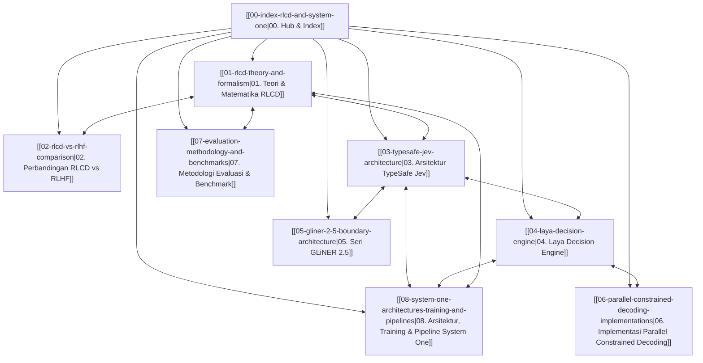

# RLCD & System One Decision Models: Hub & Index

> [!abstract] Ringkasan Eksekutif
> **RLCD** merepresentasikan pergeseran paradigma fundamental dalam machine learning: dari model generatif autoregresif (*System Two*) yang menghasilkan teks token-demi-token menuju model keputusan terkalibrasi (*System One*) yang mengevaluasi state dan menghasilkan keputusan terstruktur dengan probabilitas terkalibrasi secara matematis dalam satu *single forward pass*.

Dalam literatur dan industri AI modern (khususnya per September 2026), istilah **RLCD** mencakup dua metodologi yang saling melengkapi:
1. **Reinforcement Learning for Calibrated Decisions** (TypeSafe AI / Jev, Convai Laya): Pelatihan model keputusan non-autoregresif menggunakan *strictly proper scoring rules* (Brier score, Negative Log-Likelihood) dan penalti kalibrasi (*Expected Calibration Error* - ECE) agar tingkat kepercayaan model mencerminkan akurasi empiris sebenarnya.
2. **Reinforcement Learning from Contrastive Distillation** (Yang et al., ICLR 2024 / Meta AI & UC Berkeley): Pembangkitan data preferensi secara sintetis menggunakan pasangan *contrastive prompt* ($p^+, p^-$) untuk mengeliminasi ketergantungan pada anotasi manusia (*human feedback*) dan *LLM-as-a-judge* yang rentan *noise*.

---

## Peta Konseptual Vault (`rlcd-jev-based/`)

---

## Modul Riset

| Note | Topik Utama | Fokus & Kontribusi |
| :--- | :--- | :--- |
| **[[01-rlcd-theory-and-formalism\|01. Teori & Matematika RLCD]]** | Teori Matematika RLCD | *Strictly Proper Scoring Rules* (Brier, Logarithmic, Spherical), formulasi ECE/MCE, kalibrasi probabilitas, optimasi *policy gradient* / GRPO, dan teori *contrastive distillation* ($p^+, p^-$). |
| **[[02-rlcd-vs-rlhf-comparison\|02. Perbandingan RLCD vs RLHF]]** | RLCD vs. RLHF / PPO / DPO / RLVR | Mengapa optimasi preferensi manusia memicu *mode dropping*, *sycophancy*, dan *overconfidence*, serta perbandingan mendalam formula Bradley-Terry vs *Proper Scoring*. |
| **[[03-typesafe-jev-architecture\|03. Arsitektur TypeSafe Jev]]** | TypeSafe Jev (Flagship System One) | *Parallel Sampler*, token economics ($0.042/1M input, $0.00 output), primitive types (`Choice`, `Score`, `Noul`), formula confidence rescaled, dan jaminan 0% halusinasi. |
| **[[04-laya-decision-engine\|04. Laya Decision Engine]]** | Convai Laya (Open Source) | ModernBERT (421M) dan mmBERT (322M), latensi 32.8ms, *Unicode Script Router* lintas 51 bahasa, benchmark head-to-head vs Jev (0.766 vs 0.727 akurasi). |
| **[[05-gliner-2-5-boundary-architecture\|05. Seri GLiNER 2.5]]** | Fastino GLiNER 2.5 | Arsitektur prediksi batas (*boundary prediction*) menggantikan *span enumeration* ($O(L)$ scaling), ekstraksi entitas-relasi *joint* via *constrained beam search*, dan klasifikasi berkendala. |
| **[[06-parallel-constrained-decoding-implementations\|06. Implementasi Parallel Constrained Decoding]]** | Implementasi Praktis (Qwen, LFM) | `Qwen-2.5-1B-RLCD` (MLX / Apple Silicon, KV-cache broadcasting) dan `LFM2.5-350M-RLCD` (Liquid AI hybrid convolution-attention reuse, speedup 8.5x–63x). |
| **[[07-evaluation-methodology-and-benchmarks\|07. Metodologi Evaluasi & Benchmark]]** | Evaluasi & Benchmark | ECE, Brier Score, *Selective Classification* (Coverage pada error $\le 5\%$), Workflow Consensus Evals, serta analisis kegagalan (*failure modes*). |
| **[[08-system-one-architectures-training-and-pipelines\|08. Arsitektur, Training & Pipeline System One]]** | Arsitektur, Training & Pipeline | Komparasi *From Scratch* (ModernBERT/mmBERT) vs *Fine-Tuned* LLM/SLM (Clef/FastDecisionModel), multi-objective proper loss, dekomposisi variansi RLCD ([Gao & Wang 2026](https://arxiv.org/abs/2609.38850)), pipeline data 13-source, dan eksekusi ujung-ke-ujung $t_0 \to t_5$. |

---

## Kutipan Kunci Paradigma System One & RLCD

> [!quote] Diogo Almeida (Pendiri TypeSafe AI, Co-inventor ChatGPT & RLHF)
> "Models have been superhuman at chat for years, so where is all the automation? ... We built a new stack entirely focused on automation: with a new model architecture, parallel sampler for maximum efficiency, and training method we call Reinforcement Learning for Calibrated Decisions (RLCD)."
> — [TypeSafe AI Blog: Introducing System One Models & Jev (2026)](https://typesafe.ai/blog/introducing-system-one-models-and-jev)

> [!quote] Zhimin Gao & Pichao Wang (OpenJev-RLCD, 2026)
> "A working RLCD for reasoning models scores what the model actually decides—the answer distribution after its own rationale—with a proper score, first to calibrate that decision and then to reinforce the reasoning that feeds it... at the same accuracy as GRPO, a single RLCD query knows which of its answers to trust."
> — [OpenJev-RLCD: A Working RLCD Implementation (arXiv:2609.38850, 2026)](https://arxiv.org/abs/2609.38850)

> [!quote] Kevin Yang et al. (Meta AI, UC Berkeley, UCLA)
> "We propose Reinforcement Learning from Contrastive Distillation (RLCD), a method for aligning language models to follow principles expressed in natural language without using human feedback. RLCD creates preference pairs from two contrasting model outputs, one using a positive prompt and one using a negative prompt... resulting in cleaner preference labels in the absence of human annotations."
> — [RLCD: Reinforcement Learning from Contrastive Distillation for LM Alignment (ICLR 2024)](https://arxiv.org/abs/2307.12950)

> [!quote] Convai Innovations (Laya Model Card)
> "Trained with reinforcement learning against strictly proper scoring rules (RLCD), so reporting honest probabilities is the only way to maximise reward. It never generates text, so there is nothing to parse and nothing to hallucinate."
> — [Laya Model Card on Hugging Face (2026)](https://huggingface.co/convaiinnovations/laya)
