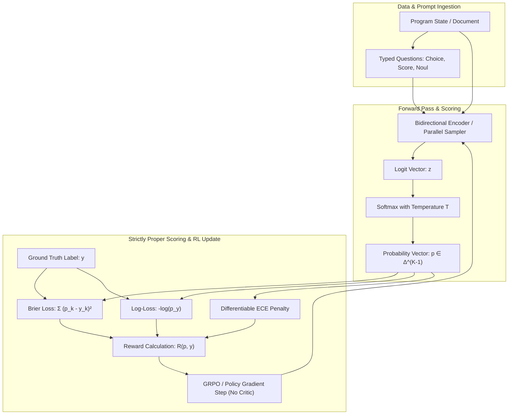

# Teori & Matematika RLCD

> [!abstract] Definisi
> **RLCD** mencakup dua kerangka kerja teoritis:
> 1. **Reinforcement Learning for Calibrated Decisions** (TypeSafe AI / [[04-laya-decision-engine|Laya]]): Kerangka kerja optimasi penguatan di mana *reward* dimodelkan menggunakan **strictly proper scoring rules** (aturan penilaian strictly proper) dan penalti kalibrasi (*Expected Calibration Error*), sehingga ekspektasi reward maksimum hanya dapat dicapai apabila model melaporkan probabilitas yang jujur (*epistemically honest*).
> 2. **Reinforcement Learning from Contrastive Distillation** (Yang et al., ICLR 2024): Metode penyelarasan (*alignment*) tanpa umpan balik manusia yang membangkitkan pasangan respon terarah menggunakan prompt kontras $(p^+, p^-)$ untuk menghasilkan label preferensi sintetis berkadar *noise* rendah berdasarkan konstruksi.

---

## 1. Intuisi

Pada model bahasa autoregresif standar yang dilatih dengan [[02-rlcd-vs-rlhf-comparison|RLHF]], fungsi reward mengukur seberapa menarik respon model bagi penilai manusia. Hal ini memicu patologi **overconfidence**: model belajar menyatakan tebakan keliru dengan nada yang sangat meyakinkan demi mendapatkan skor tinggi dari manusia.

```
Model Standar (RLHF):  "Saya 100% yakin ibukota Australia adalah Sydney."  --> Percaya diri salah
Model Terkalibrasi (RLCD): "Probabilitas Canberra 0.85, Sydney 0.15."         --> Mengakui ketidakpastian
```

Di dalam kode software otomatis (seperti penentuan rute transaksi atau deteksi penipuan), sebuah sistem membutuhkan kepastian matematis:
Jika sebuah model menyatakan probabilitas suatu kejadian adalah $0.80$, maka dalam jangka panjang, kejadian tersebut harus benar-benar terjadi sebanyak $80\%$ dari total prediksi. **Inilah yang disebut dengan Kalibrasi Probabilitas (Epistemic Calibration).**

RLCD memastikan bahwa model tidak dapat "bermain curang" (*reward hacking*): jika model melaporkan probabilitas yang terlalu percaya diri padahal salah, atau terlalu ragu padahal benar, fungsi penalti matematis (*proper scoring rule*) akan secara drastis memotong skor reward model tersebut.

---

## 2. Formalisme Matematis

### 2.1 Kalibrasi Epistemik (Epistemic Calibration)

Misalkan $X \in \mathcal{X}$ adalah input context (state), dan $Y \in \{1, \dots, K\}$ adalah label kebenaran (*ground truth*). Misalkan model memprediksi vektor probabilitas $\mathbf{p}(X) = (p_1, \dots, p_K) \in \Delta^{K-1}$, di mana $\Delta^{K-1} = \left\{ \mathbf{p} \in \mathbb{R}^K : \sum_{k=1}^K p_k = 1, p_k \ge 0 \right\}$.

Sebuah prediktor dikatakan **terkalibrasi sempurna** (*perfectly calibrated*) jika untuk setiap nilai probabilitas $p \in [0, 1]$ dan setiap kelas $k \in \{1, \dots, K\}$:

$$\mathbb{P}\left(Y = k \mid P_k(X) = p\right) = p$$

Artinya, di antara seluruh sampel di mana model memberikan probabilitas $p$, frekuensi empiris kemunculan kelas $k$ tepat sama dengan $p$.

---

### 2.2 Strictly Proper Scoring Rules

Sebuah aturan penilaian (*scoring rule*) $S(\mathbf{p}, y)$ mengevaluasi kualitas distribusi probabilitas yang diprediksi $\mathbf{p}$ terhadap realisasi hasil empiris $y \in \{1, \dots, K\}$.

> [!quote] Gneiting & Raftery (2007)
> "A scoring rule is strictly proper if the expected score under distribution $q$ is uniquely maximized when $p = q$."
> — [Strictly Proper Scoring Rules, JASA 2007](https://doi.org/10.1198/016214506000001437)

Secara formal, jika distribusi kebenaran adalah $\mathbf{q} \in \Delta^{K-1}$, maka ekspektasi skor memenuhi:

$$\mathbb{E}_{y \sim \mathbf{q}}[S(\mathbf{p}, y)] \le \mathbb{E}_{y \sim \mathbf{q}}[S(\mathbf{q}, y)], \quad \forall \mathbf{p} \in \Delta^{K-1}$$

dengan kesetaraan berlaku **jika dan hanya jika** $\mathbf{p} = \mathbf{q}$.

Dalam RLCD, digunakan tiga aturan penilaian strictly proper:

#### 1. Multi-Class Brier Score (Quadratic Scoring Rule)
Misalkan $\mathbf{y} \in \{0, 1\}^K$ adalah representasi *one-hot* dari label kelas aktual $y$. Brier score didefinisikan sebagai rata-rata kuadrat selisih probabilitas:

$$BS(\mathbf{p}, \mathbf{y}) = \frac{1}{K} \sum_{k=1}^K (p_k - y_k)^2$$

Untuk kumpulan data berukuran $N$:

$$\mathcal{L}_{\text{Brier}} = \frac{1}{N} \sum_{i=1}^N \sum_{k=1}^K (p_{ik} - y_{ik})^2$$

**Dekomposisi Murphy (1973)** membuktikan bahwa Brier Score dapat diurai secara analitis menjadi tiga komponen ortogonal:

$$\mathbb{E}[BS] = \underbrace{\sum_{m=1}^M \frac{|B_m|}{N} (\bar{p}_m - \bar{y}_m)^2}_{\text{Reliability (Calibration Error)}} - \underbrace{\sum_{m=1}^M \frac{|B_m|}{N} (\bar{y}_m - \bar{y})^2}_{\text{Resolution}} + \underbrace{\bar{y}(1 - \bar{y})}_{\text{Uncertainty}}$$

* **Reliability:** Mengukur deviasi kalibrasi antara kepercayaan prediksi $\bar{p}_m$ dan akurasi empiris $\bar{y}_m$. RLCD meminimalkan suku ini menuju $0$.
* **Resolution:** Mengukur kemampuan model memisahkan instance ke dalam probabilitas ekstrem yang berbeda dari rata-rata populasi $\bar{y}$.
* **Uncertainty:** Entropi inheren data yang tidak dapat direduksi.

#### 2. Logarithmic Scoring Rule (Negative Log-Likelihood)
$$LS(\mathbf{p}, y) = -\sum_{k=1}^K y_k \log p_k = -\log p_{y^*}$$

di mana $y^*$ adalah indeks kelas yang benar.

#### 3. Spherical Scoring Rule
$$SS(\mathbf{p}, y) = \frac{p_{y^*}}{\sqrt{\sum_{k=1}^K p_k^2}}$$

---

### 2.3 Expected Calibration Error (ECE) & Maximum Calibration Error (MCE)

Untuk mengukur kalibrasi secara empiris, seluruh prediksi dikelompokkan ke dalam $M$ interval/bin kepercayaan yang berjarak sama $B_1, B_2, \dots, B_M \subset [0, 1]$:

$$B_m = \left\{ i \in \{1, \dots, N\} : \hat{p}_i \in \left( \frac{m-1}{M}, \frac{m}{M} \right] \right\}$$

di mana $\hat{p}_i = \max_{k} p_{ik}$ adalah tingkat kepercayaan prediksi tertinggi (*top confidence*).

Akurasi empiris dan rata-rata kepercayaan di dalam setiap bin $B_m$ adalah:

$$\text{acc}(B_m) = \frac{1}{|B_m|} \sum_{i \in B_m} \mathbf{1}(\hat{y}_i = y_i)$$

$$\text{conf}(B_m) = \frac{1}{|B_m|} \sum_{i \in B_m} \hat{p}_i$$

Maka **Expected Calibration Error (ECE)** dihitung sebagai rata-rata berbobot deviasi absolut:

$$\text{ECE} = \sum_{m=1}^M \frac{|B_m|}{N} \left| \text{acc}(B_m) - \text{conf}(B_m) \right|$$

Dan **Maximum Calibration Error (MCE)** mengukur skenario terburuk (*worst-case error*):

$$\text{MCE} = \max_{m \in \{1, \dots, M\}} \left| \text{acc}(B_m) - \text{conf}(B_m) \right|$$

---

### 2.4 Fungsi Rescaling Confidence TypeSafe Jev

Pada model [[03-typesafe-jev-architecture|TypeSafe Jev]], nilai probabilitas mentah $\max_k p_k$ tidak langsung dijadikan angka `confidence`. Pada ruang keputusan dengan $K$ pilihan:
- Jika probabilitas terbagi rata secara seragam ($p_k = 1/K$), ketidakpastian berada pada titik maksimum dan confidence harus $0.0$.
- Jika seluruh probabilitas terkonsentrasi pada satu pilihan ($p_k = 1.0$), confidence adalah $1.0$.

TypeSafe menurunkan formula normalisasi:

$$\text{confidence}(\mathbf{p}) = \max\left(0, \, \min\left(1, \, \frac{K \cdot \max_{k \in \{1,\dots,K\}} p_k - 1}{K - 1}\right)\right)$$

* **Batas Bawah (Uniform):**
  $$\max_k p_k = \frac{1}{K} \implies \frac{K(1/K) - 1}{K - 1} = \frac{1 - 1}{K - 1} = 0.0$$
* **Batas Atas (Certainty):**
  $$\max_k p_k = 1.0 \implies \frac{K(1) - 1}{K - 1} = \frac{K - 1}{K - 1} = 1.0$$

---

### 2.5 Formulasi Policy Optimization RLCD

Pada model keputusan System One (seperti Jev dan Laya), kebijakan (*policy*) parameter $\theta$ menghasilkan logit $\mathbf{z}_\theta(s, q) \in \mathbb{R}^K$. Probabilitas diturunkan melalui softmax dengan temperatur $T$:

$$p_\theta(k \mid s, q) = \frac{\exp(z_k / T)}{\sum_{j=1}^K \exp(z_j / T)}$$

Fungsi reward RL dibentuk langsung dari *strictly proper scoring rule* dengan penalti kalibrasi:

$$R(p_\theta, y) = 1 - \frac{1}{2} \sum_{k=1}^K (p_\theta(k \mid s, q) - y_k)^2$$

Tujuan optimasi penguatan:

$$\max_\theta \mathcal{J}(\theta) = \mathbb{E}_{(s, q, y) \sim \mathcal{D}} \left[ R(p_\theta(s, q), y) - \lambda_{\text{cal}} \cdot \mathcal{D}_{\text{ECE}}(p_\theta) - \beta \, \mathbb{D}_{\text{KL}}(p_\theta \,\|\, p_{\text{ref}}) \right]$$

Pada arsitektur [[04-laya-decision-engine|Laya]], pembaruan gradien dilakukan menggunakan varian REINFORCE dengan baseline rata-rata kelompok (*GRPO-style group-mean baseline*):

$$\nabla_\theta \mathcal{J}(\theta) = \mathbb{E} \left[ \sum_{k=1}^K \nabla_\theta \log \pi_\theta(k \mid s, q) \cdot \left( R(p_\theta, y) - \bar{R}_{\text{group}} \right) \right]$$

---

### 2.6 Teori Contrastive Distillation (Yang et al., ICLR 2024)

Pada varian RLCD untuk model bahasa autoregresif (Kevin Yang et al.), RLCD mengatasi masalah *label noise* pada RLAIF melalui pasangan prompt terarah $p^+$ dan $p^-$.

```
p+ = Prompt Awal ⊕ Context Positif (c+)  -->  Output y+ ~ π_base(· | p+)
p- = Prompt Awal ⊕ Context Negatif (c-)  -->  Output y- ~ π_base(· | p-)
```

#### Teorema Pemisahan Sinyal (Signal-to-Noise Ratio Separation)
Asumsikan nilai atribut kualitas target $A(y) \in \mathbb{R}$ terdistribusi normal dengan variansi generasi $\sigma_{\mathcal{G}}^2$:

$$A(y \mid p) \sim \mathcal{N}(\mu(p), \sigma_{\mathcal{G}}^2)$$

1. **Kasus RLAIF (Prompt Identik $p$):**
   Kedua respon $y_1, y_2 \sim \mathcal{N}(\mu(p), \sigma_{\mathcal{G}}^2)$. Selisih kualitas adalah $A(y_1) - A(y_2) \sim \mathcal{N}(0, 2\sigma_{\mathcal{G}}^2)$. Pada batas keputusan $|A(y_1) - A(y_2)| \le \delta$:
   $$\lim_{\delta \to 0} \mathbb{P}(\text{Label Benar} \mid |A(y_1) - A(y_2)| \le \delta) = 0.5 \quad (\text{Tebakan Acak})$$
2. **Kasus RLCD (Prompt Kontras $p^+, p^-$):**
   Dengan pergeseran rerata $\Delta \mu = \mu(p^+) - \mu(p^-) > 0$, probabilitas bahwa $y^+$ secara objektif lebih baik dari $y^-$ tanpa menggunakan penilai eksternal adalah:
   $$\mathbb{P}(A(y^+) > A(y^-)) = \Phi\left( \frac{\mu(p^+) - \mu(p^-)}{\sqrt{2} \sigma_{\mathcal{G}}} \right)$$
   di mana $\Phi$ adalah CDF Gaussian standar. Pada pasangan sulit $|A(y^+) - A(y^-)| \le \delta$:
   $$\mathbb{P}_{\text{RLCD}}(A(y^+) > A(y^-) \mid |A(y^+) - A(y^-)| \le \delta) = \frac{1}{1 + \exp\left( -\frac{\Delta \mu}{\sigma_{\mathcal{G}}^2} \delta \right)} > 0.5$$

Dengan demikian, RLCD secara matematis mengeliminasi ambiguitas pada batas keputusan (*decision boundary*).

---

## 3. Visual Alur Pelatihan RLCD



---

## 4. Contoh Minimal dalam Kode

Implementasi PyTorch sederhana untuk menghitung *Brier Score Loss* dan *Expected Calibration Error (ECE)*:

```python
import torch
import torch.nn as nn
import torch.nn.functional as F

class RLCDCalibrationLoss(nn.Module):
    def __init__(self, lambda_ece: float = 0.1, n_bins: int = 10):
        super().__init__()
        self.lambda_ece = lambda_ece
        self.n_bins = n_bins

    def forward(self, logits: torch.Tensor, targets: torch.Tensor):
        # 1. Hitung probabilitas melalui Softmax
        probs = F.softmax(logits, dim=-1)  # shape: (B, K)
        
        # 2. Strictly Proper Scoring Rule: Brier Score
        targets_one_hot = F.one_hot(targets, num_classes=logits.size(-1)).float()
        brier_loss = torch.mean(torch.sum((probs - targets_one_hot) ** 2, dim=-1))
        
        # 3. Hitung ECE (Expected Calibration Error)
        confidences, predictions = torch.max(probs, dim=-1)
        accuracies = (predictions == targets).float()
        
        bin_boundaries = torch.linspace(0, 1, self.n_bins + 1, device=logits.device)
        ece = torch.zeros(1, device=logits.device)
        
        for i in range(self.n_bins):
            bin_lower = bin_boundaries[i]
            bin_upper = bin_boundaries[i + 1]
            
            in_bin = (confidences > bin_lower) & (confidences <= bin_upper)
            bin_size = in_bin.sum().float()
            
            if bin_size > 0:
                bin_acc = accuracies[in_bin].mean()
                bin_conf = confidences[in_bin].mean()
                ece += (bin_size / logits.size(0)) * torch.abs(bin_acc - bin_conf)
                
        total_loss = brier_loss + self.lambda_ece * ece
        return total_loss, brier_loss, ece

# Minimal Test
logits = torch.tensor([[2.5, 0.1, -1.0], [0.2, 1.8, 0.1]])
targets = torch.tensor([0, 1])
criterion = RLCDCalibrationLoss(lambda_ece=0.2)
loss, brier, ece = criterion(logits, targets)
print(f"Total Loss: {loss.item():.4f}, Brier: {brier.item():.4f}, ECE: {ece.item():.4f}")
```

---

## Referensi & Hubungan

- Catatan Terkait:
  - [[00-index-rlcd-and-system-one|Index Utama RLCD]]
  - [[02-rlcd-vs-rlhf-comparison|Perbandingan RLCD vs RLHF]]
  - [[03-typesafe-jev-architecture|Arsitektur TypeSafe Jev]]
  - [[04-laya-decision-engine|Laya Decision Engine]]
- Sumber Eksternal:
  - [Gneiting & Raftery (2007): Strictly Proper Scoring Rules](https://doi.org/10.1198/016214506000001437)
  - [Murphy (1973): A New Vector Partition of the Probability Score](https://doi.org/10.1175/1520-0450(1973)012<0595:ANVPOT>2.0.CO;2)
  - [Yang et al. (2024): RLCD: Reinforcement Learning from Contrastive Distillation](https://arxiv.org/abs/2307.12950)
  - [TypeSafe AI Documentation: Machine Learning Primer](https://docs.typesafe.ai/introduction/machine-learning-primer)
