# Perbandingan Mendalam: RLCD vs. RLHF

> [!abstract] Definisi
> **RLHF** (*Reinforcement Learning from Human Feedback*) adalah paradigma penyelarasan model generatif autoregresif yang memaksimalkan fungsi reward berbasis preferensi subjektif manusia, menghasilkan teks luwes namun rentan halusinasi dan *overconfidence*. 
> **RLCD** (*Reinforcement Learning for Calibrated Decisions* / *Contrastive Distillation*) adalah paradigma pelatihan keputusan yang mengoptimalkan *epistemic calibration* di bawah aturan penilaian *strictly proper*, menghasilkan keputusan diskret dengan probabilitas teruji tanpa melalui dekoding autoregresif bertahap.

---

## 1. Intuisi

Mengapa RLHF menghasilkan model yang buruk untuk otomatisasi software?

Ketika manusia diminta menilai dua jawaban AI:
1. **Manusia menyukai kepastian.** Respon yang terdengar tegas dan percaya diri ("*Tentu, langkahnya adalah X*") secara konsisten dinilai lebih tinggi daripada respon yang jujur mengakui ketidakpastian ("*Ada kemungkinan 55% X dan 45% Y*").
2. **Manusia menyukai kesopanan dan sanjungan (*Sycophancy*).** Model belajar mengiyakan premis pengguna meskipun salah.
3. **Penyusutan Moda (*Mode Dropping*).** Penalti KL dan fungsi reward Bradley-Terry memaksa model memangkas variasi distribusi output ke moda sempit yang disukai rater manusia, mengorbankan probabilitas kejadian lain yang valid.

```
                  ┌────────────────────────────────────────┐
                  │    Distribusi Model Dasar (Pretrained) │
                  │           /\          /\               │
                  │          /  \  /\    /  \              │
                  └─────────/────\/──\──/────\─────────────┘
                                      │
                 RLHF (Optimasi Preferensi Manusia)
                                      ▼
                  ┌────────────────────────────────────────┐
                  │   Mode Dropping: Distribusi Menyempit │
                  │              |                         │
                  │             / \                        │
                  │            /   \                       │
                  └───────────/─────\──────────────────────┘
                   Model kehilangan kalibrasi ketidakpastian
```

Di dalam sistem perangkat lunak kritis (misal: otorisasi pengembalian dana atau triage tiket), perilaku "sok tahu" ini fatal. Software tidak membutuhkan obrolan persuasif; software membutuhkan nilai boolean atau kategori yang disertai **angka probabilitas yang dapat dipercaya** (*calibrated uncertainty*).

> [!quote] TypeSafe AI (AI Primer)
> "RLHF teaches a model to say things that people prefer. That objective works well for chatbots, but it can also reward sycophancy and confident-sounding hallucinations. Preference optimization also causes mode dropping: the model learns to favor a particular style while reducing the probability of other possible outputs."
> — [TypeSafe AI Primer (2026)](https://docs.typesafe.ai/introduction/machine-learning-primer)

---

## 2. Formalisme Matematis

### 2.1 Formulasi RLHF Tradisional (Bradley-Terry & PPO)

#### Reward Model Training (Bradley-Terry Formulation)
Diberikan prompt $x$ dan pasangan respon $(y_w, y_l)$ di mana $y_w \succ y_l$ dipilih oleh rater manusia. Peluang preferensi dimodelkan menurut hukum **Bradley-Terry (1952)**:

$$P(y_w \succ y_l \mid x) = \sigma\left( r_\phi(x, y_w) - r_\phi(x, y_l) \right) = \frac{1}{1 + \exp\left( -(r_\phi(x, y_w) - r_\phi(x, y_l)) \right)}$$

Fungsi loss model reward $r_\phi$:

$$\mathcal{L}_{\text{RM}}(\phi) = -\mathbb{E}_{(x, y_w, y_l) \sim \mathcal{D}} \left[ \log \sigma\left( r_\phi(x, y_w) - r_\phi(x, y_l) \right) \right]$$

#### Optimasi Kebijakan via PPO
Kebijakan autoregresif $\pi_\theta$ dioptimalkan untuk memaksimalkan reward terhadap model referensi $\pi_{\text{ref}}$ (checkpoint SFT):

$$\max_\theta \mathcal{J}_{\text{PPO}}(\theta) = \mathbb{E}_{x \sim \mathcal{D}, y \sim \pi_\theta(\cdot \mid x)} \left[ r_\phi(x, y) - \beta \, \mathbb{D}_{\text{KL}}\left( \pi_\theta(y \mid x) \,\|\, \pi_{\text{ref}}(y \mid x) \right) \right]$$

Objective clipped surrogate PPO per token:

$$\mathcal{L}_{\text{CLIP}}(\theta) = \hat{\mathbb{E}}_t \left[ \min\left( \frac{\pi_\theta(a_t \mid s_t)}{\pi_{\theta_{\text{old}}}(a_t \mid s_t)} \hat{A}_t, \, \text{clip}\left( \frac{\pi_\theta(a_t \mid s_t)}{\pi_{\theta_{\text{old}}}(a_t \mid s_t)}, 1-\epsilon, 1+\epsilon \right) \hat{A}_t \right) \right]$$

---

### 2.2 Formulasi Direct Preference Optimization (DPO)

Rafailov et al. (2023) membuktikan bahwa optimasi PPO terkendala KL di atas dapat dipecahkan secara analitis tanpa model reward terpisah:

$$r^*(x, y) = \beta \log \frac{\pi^*(y \mid x)}{\pi_{\text{ref}}(y \mid x)} + \beta \log Z(x)$$

Dengan mensubstitusikan persamaan ini langsung ke dalam Bradley-Terry loss, diperoleh **DPO Loss**:

$$\mathcal{L}_{\text{DPO}}(\theta) = -\mathbb{E}_{(x, y_w, y_l) \sim \mathcal{D}} \left[ \log \sigma\left( \beta \log \frac{\pi_\theta(y_w \mid x)}{\pi_{\text{ref}}(y_w \mid x)} - \beta \log \frac{\pi_\theta(y_l \mid x)}{\pi_{\text{ref}}(y_l \mid x)} \right) \right]$$

*Kelemahan:* DPO tetap mengoptimalkan perankingan teks generatif subjektif dan tidak memberikan jaminan kalibrasi probabilitas kelas.

---

### 2.3 Formulasi RLVR & GRPO

Pada *Reinforcement Learning with Verifiable Rewards* (RLVR), reward manusia diganti dengan verifier otomatis $r_{\text{rule}}(x, y) \in \{0, 1\}$ (misal: kompiler kode atau theorem prover). Pada **GRPO** (*Group Relative Policy Optimization*), fungsi nilai (critic) dihilangkan dengan menormalisasi reward atas kelompok $G$ sampel:

$$\mathcal{L}_{\text{GRPO}}(\theta) = -\frac{1}{G} \sum_{i=1}^G \left[ \min\left( \frac{\pi_\theta(y_i \mid x)}{\pi_{\theta_{\text{old}}}(y_i \mid x)} \tilde{A}_i, \, \text{clip}\left( \frac{\pi_\theta(y_i \mid x)}{\pi_{\theta_{\text{old}}}(y_i \mid x)}, 1-\epsilon, 1+\epsilon \right) \tilde{A}_i \right) - \beta \, \mathbb{D}_{\text{KL}}\left(\pi_\theta \,\|\, \pi_{\text{ref}}\right) \right]$$

di mana keuntungan (*advantage*) dihitung secara relatif:

$$\tilde{A}_i = \frac{r(x, y_i) - \text{mean}(\{r(x, y_j)\}_{j=1}^G)}{\text{std}(\{r(x, y_j)\}_{j=1}^G) + \epsilon}$$

---

### 2.4 Formulasi RLCD untuk Model Keputusan Terkalibrasi

Berbeda dari RLHF/DPO/GRPO di atas yang menghasilkan urutan token $y = (y_1, \dots, y_T)$, RLCD pada model System One menghasilkan vektor distribusi diskret $\mathbf{p} \in \Delta^{K-1}$ dalam **satu forward pass tunggal**.

Fungsi reward RLCD didefinisikan melalui aturan penilaian *strictly proper* (Brier Score) dikurangi penalti kalibrasi ECE:

$$R_{\text{RLCD}}(\mathbf{p}, y) = 1 - \frac{1}{2} \sum_{k=1}^K (p_k - \mathbf{1}_{y=k})^2 - \lambda_{\text{ECE}} \cdot \left| \max_k p_k - \text{acc}(B_m) \right|$$

Tujuan optimasi RLCD:

$$\max_\theta \mathbb{E}_{(s, q, y) \sim \mathcal{D}} \left[ R_{\text{RLCD}}(\mathbf{p}_\theta(s, q), y) - \beta \, \mathbb{D}_{\text{KL}}(\mathbf{p}_\theta \,\|\, \mathbf{p}_{\text{ref}}) \right]$$

Sifat matematis penting:
1. **Invariansi terhadap nada suara:** Karena model tidak menghasilkan teks bebas, model tidak dapat meningkatkan reward melalui kalimat yang persuasif.
2. **Kompensasi Risiko Jujur:** Melaporkan $p_k = 0.5$ pada kasus yang memang ambigu menghasilkan ekspektasi reward yang lebih tinggi daripada bertaruh $p_k = 1.0$ yang berujung salah.

---

## 3. Matriks Perbandingan Komprehensif

| Dimensi | Traditional RLHF (PPO) | Direct Preference Optimization (DPO) | RLVR (e.g. GRPO) | RLCD: Contrastive Distillation | RLCD: Calibrated Decisions |
| :--- | :--- | :--- | :--- | :--- | :--- |
| **Model Arsitektur** | Autoregressive Decoder ($O(T)$ langkah) | Autoregressive Decoder ($O(T)$ langkah) | Autoregressive Decoder ($O(T)$ CoT panjang) | Autoregressive Decoder ($O(T)$ langkah) | **Bidirectional Encoder / Parallel Sampler ($O(1)$)** |
| **Target Output** | String / Teks bebas | String / Teks bebas | String alasan + Jawaban akhir | String / Teks bebas | **Nilai terstruktur bertipe (`Choice`, `Score`, `Noul`)** |
| **Fungsi Loss Utama** | Bradley-Terry $\mathcal{L}_{\text{RM}}$ + PPO $\mathcal{L}_{\text{CLIP}}$ | $\mathcal{L}_{\text{DPO}}$ (Implicit reward ratio) | $\mathcal{L}_{\text{GRPO}}$ dengan verifier deterministik | $\mathcal{L}_{\text{RM}}$ dari $(p^+, p^-)$ + PPO/DPO | **Strictly Proper Scoring Rules ($BS$, $NLL$) + Penalti ECE** |
| **Sinyal Supervisi** | Perankingan subjektif rater manusia $(y_w \succ y_l)$ | Dataset preferensi manusia offline | Verifier kode / matematika ($0$ atau $1$) | Pasangan prompt kontras tanpa manusia | **Verifikasi hasil empiris / Konsensus multi-model** |
| **Kalibrasi Probabilitas** | **Sangat Buruk:** Overconfident & terdistorsi | **Buruk:** Log-odds tidak terkalibrasi ke probabilitas dunia nyata | Terkalibrasi sebagian pada domain biner | **Buruk:** Hanya mengukur perankingan pasangan | **Matematis Terkalibrasi:** $\mathbb{P}(Y=k \mid \hat{p}_k) = p_k$ |
| **Patologi Utama** | *Mode dropping*, *sycophancy*, halusinasi | *Overfitting* ke kebijakan referensi | Eksplorasi runtuh (*reward hacking*) | Kebocoran gaya antara $p^+$ dan $p^-$ | Degradasi pada kardinalitas tinggi ($K > 20$) pada encoder kecil |
| **Latensi Inferensi** | $1.000\text{ ms} - 5.000\text{ ms}$ | $1.000\text{ ms} - 5.000\text{ ms}$ | $3.000\text{ ms} - 60.000\text{ ms}$ | $1.000\text{ ms} - 5.000\text{ ms}$ | **$30\text{ ms} - 250\text{ ms}$ (Sub-35ms pada Laya)** |
| **Biaya Output Token** | Mahal ($\sim \$10 - \$15$ per 1M token) | Mahal ($\sim \$10 - \$15$ per 1M token) | Sangat Mahal (penalaran panjang) | Mahal ($\sim \$10 - \$15$ per 1M token) | **$\$0.00$ (Gratis, tanpa token output)** |
| **Toleransi Error Tipe** | Tidak dijamin (parser JSON bisa gagal) | Tidak dijamin | Tidak dijamin | Tidak dijamin | **$100\%$ Valid (Tidak mungkin salah tipe)** |

---

## 4. Visual Perbandingan Alur Inferensi

```mermaid
graph TD
    subgraph "Autoregressive LLM (RLHF / DPO)"
        A1[Prompt Input] --> B1[Forward Pass Token 1]
        B1 --> B2[Forward Pass Token 2]
        B2 --> B3[Forward Pass Token 3]
        B3 --> B4[Forward Pass Token ... T]
        B4 --> C1[Output: Free-form String / JSON String]
        C1 --> D1{JSON Parser}
        D1 -->|Sukses: 95%| E1[Eksekusi Software]
        D1 -->|Gagal/Halusinasi: 5%| F1[Crash / Runtime Exception]
    end

    subgraph "System One Decision Engine (RLCD)"
        A2[State Input ⊕ Typed Questions] --> B_ONE[Single Forward Pass: O 1 Latency]
        B_ONE --> C2[Parallel Decision Heads: Choice, Score, Noul]
        C2 --> D2[Output: Exact Typed Values + Calibrated Confidence]
        D2 --> E2[Eksekusi Software Langsung Tanpa Parsing: 100% Type-Safe]
    end
```



---

## 5. Contoh Minimal Perbandingan Respons

### Contoh Kasus: Triage Transaksi Mencurigakan

#### Respon Model RLHF (misal: GPT-4o / Claude 3.5 Sonnet dalam JSON Mode):
```json
{
  "thought": "The user was billed twice within 5 minutes. This is clearly a duplicate charge caused by gateway latency. I am completely confident this requires an immediate refund.",
  "action": "refund",
  "confidence": 0.99
}
```
*Kelemahan:* Latensi $1.800\text{ ms}$. Token output berbayar. Angka `0.99` adalah probabilitas sintaksis token `"0.99"`, bukan probabilitas empiris terkalibrasi.

#### Respon Model RLCD (TypeSafe Jev / Laya):
```json
{
  "answers": {
    "action": {
      "choice": "refund",
      "probabilities": {
        "refund": 0.82,
        "investigate": 0.15,
        "ignore": 0.03
      },
      "confidence": 0.73
    },
    "duplicate_detected": {
      "noul": 0.89
    }
  }
}
```
*Keunggulan:* Dihasilkan dalam **$33\text{ ms}$**. Biaya token output $\$0.00$. Software dapat menerapkan ambang batas risiko (*risk gating*): karena `confidence` ($0.73$) berada di bawah batas otomatisasi penuh ($0.85$), software secara aman meminta konfirmasi satu kali kepada pengguna alih-alih mengeksekusi secara membabi buta.

---

## Referensi & Hubungan

- Catatan Terkait:
  - [[00-index-rlcd-and-system-one|Index Utama RLCD]]
  - [[01-rlcd-theory-and-formalism|Teori & Matematika RLCD]]
  - [[03-typesafe-jev-architecture|Arsitektur TypeSafe Jev]]
  - [[07-evaluation-methodology-and-benchmarks|Metodologi Evaluasi & Benchmark]]
  - [[RLCD_VS_RLHF]]
- Sumber Eksternal:
  - [Ouyang et al. (2022): Training language models to follow instructions with human feedback (InstructGPT)](https://arxiv.org/abs/2203.02155)
  - [Rafailov et al. (2023): Direct Preference Optimization](https://arxiv.org/abs/2305.18290)
  - [TypeSafe AI Blog: Introducing System One Models and Jev](https://typesafe.ai/blog/introducing-system-one-models-and-jev)
