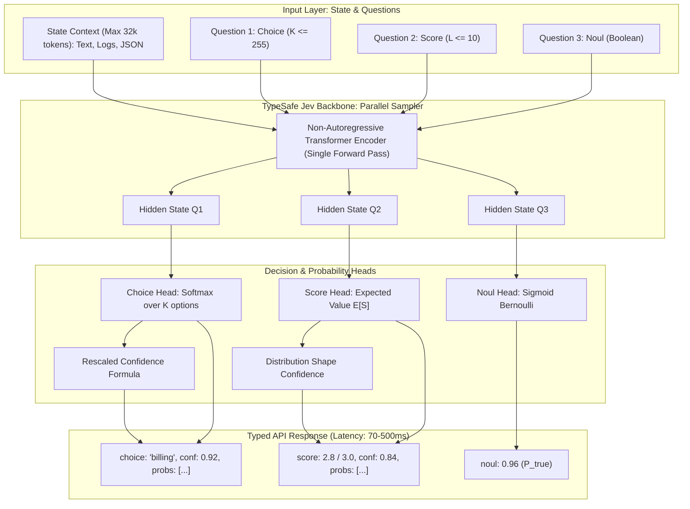

# Arsitektur TypeSafe Jev: Flagship System One Model

> [!abstract] Definisi
> **TypeSafe Jev** adalah model AI *System One* komersial pertama di dunia yang dirancang khusus untuk pengambilan keputusan terstruktur di dalam software. Alih-alih menghasilkan teks secara autoregresif, Jev mengonsumsi *state* kontekstual dan mengevaluasi kumpulan pertanyaan bertipe (*typed questions*) secara paralel dalam satu *forward pass* tunggal ($70\text{--}500\text{ ms}$), menghasilkan keputusan diskret dengan probabilitas terkalibrasi secara matematis.

---

## 1. Intuisi

Pada tahun 2026, **Diogo Almeida** (salah satu penemu ChatGPT dan perintis RLHF di OpenAI) mendirikan **TypeSafe AI**. Motivasinya berakar dari sebuah paradoks industri:
*Meskipun LLM telah mencapai kemampuan manusia super dalam percakapan, otomatisasi perangkat lunak skala besar tetap lambat, mahal, dan rapuh.*

Almeida menyadari bahwa 99% interaksi otomatisasi di masa depan adalah interaksi **AI-ke-Software (Machine-to-Machine)**, bukan manusia-ke-AI. Software tidak memerlukan narasi yang memikat, melainkan sifat-sifat komputasi yang teruji:
- **Kecepatan eksekusi** ($<100\text{ ms}$).
- **Determinisme tipe data** (tidak boleh ada error sintaksis JSON atau atribut hilang).
- **Kepastian probabilitas** (kemampuan menyatakan "saya tidak yakin").
- **Biaya marjinal mendekati nol**.

### Paradoks Jevons (The Jevons Paradox)
Jev dinamai menurut ekonom abad ke-19, William Stanley Jevons. Jevons mengamati bahwa ketika mesin uap James Watt menjadi jauh lebih efisien dalam mengonsumsi batu bara, konsumsi batu bara total dunia justru melonjak ribuan kali lipat karena tenaga uap menjadi ekonomis untuk ribuan industri baru.

Dengan memangkas biaya keputusan cerdas sebesar $400\times$ (menjadi **$\$0.042$ per 1 juta token input** dan **token output gratis**), Jev memungkinkan integrasi AI di dalam loop terdalam software: pengurutan data real-time, verifikasi per baris kode, hingga loop kontrol game $10\text{ Hz}$.

> [!quote] Diogo Almeida (Pendiri TypeSafe AI)
> "Think of Jev as a frontier-intelligence function call: unstructured state in, typed probabilistic decisions out. ... While Jev gives up string generation, it’s optimized for structured outputs and can’t hallucinate."
> — [TypeSafe AI Blog: Introducing System One Models and Jev (2026)](https://typesafe.ai/blog/introducing-system-one-models-and-jev)

---

## 2. Tiga Primitif Keputusan (Decision Primitives)

Jev membatasi seluruh ruang output pada tiga bentuk primitif matematis:

| Primitif | Bentuk Pertanyaan | Ruang Output | Output yang Dikembalikan | Kasus Penggunaan Khas |
| :--- | :--- | :--- | :--- | :--- |
| **`Choice`** | "Pilihan mana yang sesuai?" | Himpunan kategori diskret $K \in [2, 255]$ | `choice`, `probabilities`, `confidence` | Perutean tiket, klasifikasi intent, seleksi API |
| **`Score`** | "Pada tingkatan mana hal ini berada?" | Rubrik ordinal $L \in [2, 10]$ tingkatan | `score` (skalar harapan), `legend`, `probabilities`, `confidence` | Tingkat urgensi tiket, skor sentimen frustrasi |
| **`Noul`** | "Apakah pernyataan ini benar?" | Boolean biner (True / False) | `noul` (probabilitas terkalibrasi $p \in [0.0, 1.0]$) | Deteksi jailbreak, deteksi duplikasi, risiko churn |

---

## 3. Formalisme Matematis Arsitektur Jev

### 3.1 Parallel Sampler vs. Autoregressive Decoding

Pada LLM autoregresif standar, probabilitas token urutan dihitung secara berantai:

$$P(y_1, y_2, \dots, y_T \mid x) = \prod_{t=1}^T P(y_t \mid x, y_{<t})$$

Setiap token $y_t$ membutuhkan satu forward pass penuh melalui seluruh layer Transformer, dibatasi oleh *GPU memory bandwidth* saat membaca *KV-cache*. Latensi total adalah:

$$T_{\text{autoregressive}} = \sum_{t=1}^T t_{\text{step}}(t) \approx 1.500\text{ ms} - 10.000\text{ ms}$$

Pada **Parallel Sampler Jev**, seluruh konteks state $S$ dan pertanyaan $Q = \{q_1, \dots, q_M\}$ dienkode secara simultan melalui arsitektur transformer non-autoregresif:

$$\mathbf{H} = \text{Encoder}(S, q_1, \dots, q_M) \in \mathbb{R}^{L_{\text{total}} \times d}$$

Untuk setiap pertanyaan $q_m$, kepala proyeksi independen menghitung seluruh distribusi keputusan dalam satu langkah:

$$\mathbf{z}_m = \mathbf{W}_m \mathbf{h}_{q_m} + \mathbf{b}_m \in \mathbb{R}^{K_m}$$

$$\mathbf{p}_m = \text{softmax}\left( \frac{\mathbf{z}_m}{T} \right) \in \Delta^{K_m - 1}$$

Latensi eksekusi adalah $O(1)$ terhadap panjang output:

$$T_{\text{Jev}} = t_{\text{prefill}}(S, Q) \approx 70\text{ ms} - 500\text{ ms}$$

---

### 3.2 Formulasi Matematis Tiga Primitif

#### 1. Formulasi `Choice`
Diberikan himpunan pilihan $\mathcal{C} = \{c_1, \dots, c_K\}$ dengan $2 \le K \le 255$:

$$p_k = P(Y = c_k \mid S, q) = \frac{\exp(z_k / T)}{\sum_{j=1}^K \exp(z_j / T)}$$

Opsi yang dipilih adalah argmax:

$$c^* = \arg\max_{k \in \{1,\dots,K\}} p_k$$

#### 2. Formulasi `Score`
Diberikan rubrik ordinal $L$ tingkatan dengan nilai skalar terurut $v(l_1) < v(l_2) < \dots < v(l_L)$:

$$p_j = P(Y = l_j \mid S, q) = \frac{\exp(z_j / T)}{\sum_{m=1}^L \exp(z_m / T)}$$

Skor akhir yang dikembalikan adalah **ekspektasi matematis** atas rubrik tersebut:

$$\bar{S} = \mathbb{E}[v(L)] = \sum_{j=1}^L p_j \cdot v(l_j)$$

#### 3. Formulasi `Noul`
Untuk pertanyaan biner ya/tidak:

$$p = P(\text{True} \mid S, q) = \sigma(z) = \frac{1}{1 + e^{-z}}$$

---

### 3.3 Formulasi Normalisasi Confidence

Pada primitif `Choice` dan `Score`, Jev menghitung metrik skalar `confidence` $\in [0, 1]$ dari bentuk distribusi probabilitas:

$$\text{confidence}(\mathbf{p}) = \max\left( 0, \, \min\left( 1, \, \frac{K \cdot \max_{k} p_k - 1}{K - 1} \right) \right)$$

* Sifat Uniform: Jika semua pilihan sama mungkin ($p_k = 1/K$), $\text{confidence} = 0.0$.
* Sifat Pasti: Jika satu pilihan bernilai $1.0$, $\text{confidence} = 1.0$.

---

### 3.4 Teorema Jaminan 0% Halusinasi

Pada model generatif teks, ruang probabilitas didefinisikan atas kosakata token $\mathcal{V}$ ($|\mathcal{V}| \approx 32.000 - 128.000$). Ruang string yang valid di bawah skema target $\mathcal{S}$ adalah subset amat kecil $\mathcal{L}(\mathcal{S}) \subset \mathcal{V}^*$. Peluang terjadinya pelanggaran skema atau halusinasi selalu non-nol:

$$\mathbb{P}(\text{Hallucination}) = 1 - \mathbb{P}(y \in \mathcal{L}(\mathcal{S})) > 0$$

Pada Jev, layer output tidak memproyeksikan ke $\mathcal{V}$. Output diproyeksikan langsung ke ruang simpleks yang telah dibatasi di awal:

$$\mathcal{Y}_{\text{Jev}} \equiv \Delta^{K-1}$$

Karena tidak ada mekanisme bagi model untuk memilih token di luar indeks $k \in \{1, \dots, K\}$, maka secara matematis:

$$\mathbb{P}(\text{Type Error}) = 0.0, \quad \mathbb{P}(\text{Schema Violation}) = 0.0$$

---

## 4. Diagram Arsitektur Jev



---

## 5. Contoh Minimal Kode: Integrasi TypeSafe SDK

Penggunaan resmi TypeSafe Python SDK dengan pola *Confidence-Gated Routing*:

```python
from typesafe_sdk import TypeSafeClient, Choice, Score, Noul

client = TypeSafeClient(model="jev-latest")

# 1. Definisikan state kontekstual (email pelanggan & status akun)
state = {
    "customer_id": "cust_9921",
    "tier": "enterprise",
    "message": "We were charged twice for our renewal invoice #INV-2026-09. Please issue a refund immediately or we will terminate our contract.",
    "account_balance": 0.0,
    "disputed_amount": 1200.00
}

# 2. Ajukan kumpulan pertanyaan independen sekaligus
questions = {
    "intent": Choice(
        instructions="What is the primary customer request?",
        criteria={
            "refund_request": "Customer requests a refund for charges",
            "invoice_dispute": "Customer questions invoice accuracy without requesting refund",
            "cancellation": "Customer wants to cancel contract immediately",
            "support": "Technical help required"
        }
    ),
    "urgency": Score(
        instructions="Evaluate the urgency and frustration level.",
        criteria=[
            "Calm, routine inquiry",
            "Moderate concern",
            "High urgency / frustrated",
            "Critical churn threat or legal action"
        ]
    ),
    "churn_risk": Noul(
        instructions="Does the customer threaten to churn or cancel service?"
    )
}

# 3. Eksekusi satu panggilan API (70-250ms)
response = client.system_one(state=state, questions=questions)

intent_res = response.answers["intent"]
urgency_res = response.answers["urgency"]
churn_res = response.answers["churn_risk"]

print(f"Intent : {intent_res.choice} (Confidence: {intent_res.confidence:.2f})")
print(f"Urgency: {urgency_res.score:.2f} / 3.0")
print(f"Churn  : {churn_res.noul:.1%}")

# 4. Pola Keputusan dalam Kode Software (Confidence-Gated Action)
if intent_res.confidence >= 0.85 and intent_res.choice == "refund_request":
    if churn_res.noul > 0.80:
        # Prioritas tinggi: Notifikasi Account Executive + Siapkan draf refund
        print("ACTION: Auto-drafting refund with high-priority executive alert.")
    else:
        print("ACTION: Processing automated refund.")
else:
    # Model ragu-ragu: Jangan menebak, alihkan ke kurasi manusia
    print("ACTION: Low confidence. Escalate to human support representative.")
```

---

## Referensi & Hubungan

- Catatan Terkait:
  - [[00-index-rlcd-and-system-one|Index Utama RLCD]]
  - [[01-rlcd-theory-and-formalism|Teori & Matematika RLCD]]
  - [[02-rlcd-vs-rlhf-comparison|Perbandingan RLCD vs RLHF]]
  - [[04-laya-decision-engine|Laya Decision Engine]]
  - [[07-evaluation-methodology-and-benchmarks|Metodologi Evaluasi & Benchmark]]
- Sumber Eksternal:
  - [TypeSafe AI: System One Models Documentation](https://docs.typesafe.ai/concepts/system-one)
  - [TypeSafe AI: Primitives Reference](https://docs.typesafe.ai/primitives)
  - [TypeSafe AI: Confidence Formulation](https://docs.typesafe.ai/confidence)
  - [TypeSafe AI: Introducing Jev Blog Post](https://typesafe.ai/blog/introducing-system-one-models-and-jev)
