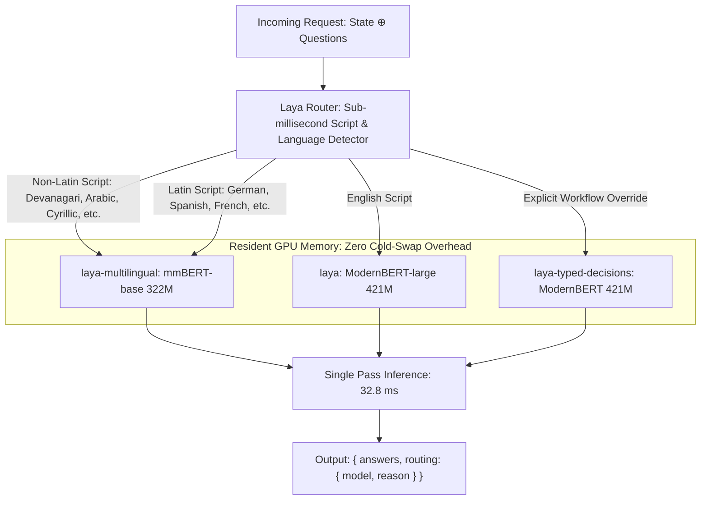

# Laya Decision Engine: Arsitektur & Implementasi Open-Source System 1

> [!abstract] Definisi
> **Laya** (dikembangkan oleh Convai Innovations / NandhaKishorM, September 2026) adalah mesin keputusan *System 1* non-autoregresif open-source pertama yang mendukung lebih dari 100 bahasa. Dibangun di atas backbone bidirectional encoder (ModernBERT-large dan mmBERT-base) dengan lisensi Apache 2.0, Laya mengevaluasi pertanyaan bertipe (`choice`, `score`, `noul`) dalam **satu forward pass berkecepatan $32.8\text{ ms}$** pada GPU komoditas (Tesla T4) dengan probabilitas terkalibrasi secara matematis melalui RLCD.

---

## 1. Intuisi & Latar Belakang

Setelah kemunculan model komersial tertutup seperti [[03-typesafe-jev-architecture|TypeSafe Jev]], komunitas open-source menghadapi tantangan:
Bagaimana menjalankan pengambilan keputusan berlatensi rendah tanpa bergantung pada API eksternal yang dimeterai (*metered cloud API*), dengan jaminan privasi data penuh dan kemampuan *on-premise*?

Laya membuktikan bahwa model bahasa autoregresif berukuran raksasa (7B–70B) tidak diperlukan untuk tugas-tugas penentuan rute (*routing*), guardrails, atau klasifikasi email. Sebuah bidirectional encoder berukuran 421M parameter yang dilatih khusus dengan **RLCD** mampu melampaui akurasi model fondasi besar dengan latensi $6\text{--}8\times$ lebih cepat dan biaya komputasi $\$0.00$.

```
Generative LLM (Ollama / Llama-3-8B):  Latensi ~1.800 ms  | Konsumsi VRAM ~16 GB | Perlu Parser JSON
Laya System 1 (ModernBERT 421M):       Latensi 32.8 ms    | Konsumsi VRAM ~1.2 GB| 100% Type-Safe
```

> [!quote] Convai Innovations (Laya Technical Announcement)
> "Laya evaluates typed questions over any state in a single forward pass — 33 ms for one question, 7.2 ms/question batched, measured on a T4. No text generation, so nothing to parse and nothing to hallucinate."
> — [Laya GitHub Repository (2026)](https://github.com/NandhaKishorM/laya)

---

## 2. Arsitektur & Tiga Checkpoint

Laya mengemas tiga checkpoint spesialis di dalam satu hub Hugging Face (`convaiinnovations/laya`):

| Checkpoint | Backbone Encoder | Parameter | Konteks Token | Spesialisasi Utama |
| :--- | :--- | :--- | :--- | :--- |
| **`laya`** (Root Repo) | ModernBERT-large | 421M | 512 (`head_max_len = 192`) | Bahasa Inggris, LLM guardrails, triage email |
| **`laya-multilingual`** | mmBERT-base | 322M | 1.024 (hingga 8k RoPE) | 100+ bahasa, ~2.2x lebih cepat |
| **`laya-typed-decisions`** | ModernBERT-large | 421M | 1.024 (`head_max_len = 256`) | Alur kerja software terstruktur (faktur, sekuritas) |

### 2.1 Desain Decision Head
- **Backbone Enkoder:** ModernBERT-large (395M, bidirectional, fully fine-tuned) atau mmBERT-base (322M, 22 layer, 256k vocab).
- **Kepala Keputusan (*Decision Head*):** 2 layer Transformer yang dilatih dari awal, terdiri dari:
  1. *Option-Marker Scorer*: Setiap opsi pertanyaan dievaluasi pada token `[MASK]` khususnya sendiri, kemudian di-softmax terhadap opsi pertanyaan tersebut.
  2. *Act/Escalate Head*: Memprediksi apakah sistem harus mengeksekusi aksi secara otomatis atau mengeskalasikan kasus ke manusia/System 2.

---

## 3. Formalisme Pelatihan RLCD pada Laya

### 3.1 Prosedur Pelatihan RLCD
Laya mengimplementasikan RLCD murni berbasis aturan penilaian *strictly proper*:

1. **Eksplorasi Kebijakan (*Policy Exploration*):**
   Kebijakan melaporkan distribusi probabilitas $\mathbf{p}$. Untuk mendorong eksplorasi saat pelatihan RL, derau Gaussian dengan rata-rata nol ditambahkan pada logit mentah $\mathbf{z}$:
   $$\tilde{z}_k = z_k + \epsilon_k, \quad \epsilon_k \sim \mathcal{N}(0, \sigma^2)$$
   $$\mathbf{p} = \text{softmax}\left( \frac{\tilde{\mathbf{z}}}{T} \right)$$
2. **Kombinasi Reward Strictly Proper:**
   Reward dihitung dari gabungan skor logaritmik dan sferis:
   $$R(\mathbf{p}, y) = \alpha \log(p_y) + (1 - \alpha) \frac{p_y}{\sqrt{\sum_{k=1}^K p_k^2}}$$
   Untuk pertanyaan ordinal (`Score`), ditambahkan *Ranked Probability Score* (RPS) untuk mempertahankan hubungan jarak antar level.
3. **Pembaruan Gradien (GRPO-style REINFORCE):**
   Pembaruan bobot menggunakan algoritma REINFORCE dengan baseline rata-rata kelompok tanpa jaringan critic:
   $$\nabla_\theta \mathcal{J}(\theta) = \mathbb{E} \left[ \sum_{k=1}^K \nabla_\theta \log \pi_\theta(k \mid s, q) \cdot \left( R(\mathbf{p}, y) - \bar{R}_{\text{group}} \right) \right]$$
   Untuk percakapan multi-turn, Laya menerapkan algoritma $\text{TD}(\lambda = 1.0)$ pada irisan prefiks percakapan.

---

### 3.2 Mesin Router & Pencegahan Runtuh Skrip (Script Collapse)

Salah satu penemuan penting Laya pada pengujian 51 bahasa benchmark MASSIVE adalah fenomena **Script Collapse**:
Model yang dilatih hanya pada teks alfabet Latin (seperti checkpoint Inggris) mengalami kegagalan katastropik saat membaca alfabet non-Latin.

> [!quote] Elena Varga (LavX News)
> "On Khmer text, the English checkpoint achieved 0% accuracy while reporting 95.2% confidence. Armenian text yielded 5% accuracy at 88.5% confidence. The confidence signal provides no warning when the model cannot read the input."
> — [LavX News: Laya offers open-source alternative (2026)](https://news.lavx.hu/article/laya-offers-open-source-alternative-to-proprietary-ai-decision-engines-hitting-32ms-latency)

Karena model tetap percaya diri meskipun salah total, *confidence gating* tidak dapat melindungi sistem. Untuk mengatasinya, Laya menyertakan **`Router`** berbasis Python murni yang bekerja dalam sub-milidetik ($<0.5\text{ ms}$):

$$\text{Decision} = \begin{cases}
\texttt{laya-multilingual}, & \text{jika skrip non-Latin terdeteksi (22 alfabet)} \\
\texttt{laya-multilingual}, & \text{jika skrip Latin namun stopword menunjukkan bahasa non-Inggris} \\
\texttt{laya (English)}, & \text{jika teks berbahasa Inggris}
\end{cases}$$

Dengan teknik *preloading*, kedua model disimpan dalam memori VRAM GPU, menghilangkan latensi *cold-swap* (yang memakan waktu 7–10 detik).

---

## 4. Benchmark Head-to-Head: Laya vs. TypeSafe Jev

Hasil pengujian pada benchmark publik bersama (Tesla T4 GPU):

| Benchmark / Metrik | TypeSafe Jev 1.13.0 | Laya (Routed) | Analisis Komparatif |
| :--- | :--- | :--- | :--- |
| **`typed-decisions` (2.000 keputusan)** | 0.727 | **0.766** | **Laya +0.039** (Melampaui *teacher ceiling* 0.735) |
| **AG News (4 label)** | 0.910 | **0.950** | **Laya +0.040** |
| **DAIR Emotion (6 label)** | 0.480 | **0.595** | **Laya +0.115** (Jev memberi probabilitas 0 pada label benar di 16% kasus) |
| **Banking77 (72 vs 77 label)** | **0.870** | 0.425 | **Jev unggul signifikan pada kardinalitas tinggi ($K > 20$)** |
| **Expected Calibration Error (ECE)** | 0.246 | **0.081** | **Laya $3\times$ lebih terkalibrasi** (setelah temperature scaling) |
| **Latensi p50 (1 pertanyaan)** | 236–276 ms | **32.8 ms** | **Laya $7.8\times$ lebih cepat** |
| **Throughput Batched (10 q/call)** | ~25 ms / pertanyaan | **7.2 ms / pertanyaan** | Laya mencapai 103–332 pertanyaan/detik per T4 |
| **Lisensi & Model Weights** | Proprietary API | **Apache 2.0 Open Weights** | Laya dapat di-hosting mandiri (*on-premise*) |
| **Biaya per 1M Token** | $0.042 | **$0.00** | Laya 100% bebas biaya token |

---

### Batasan dan Kelemahan Laya (Honest Limits)

1. **Degradasi Kardinalitas Tinggi ($K > 20$):**
   Pada Banking77 (77 kelas), akurasi Laya anjlok ke 0.425. Ini disebabkan oleh alokasi token `head_max_len` (192 token pada model Inggris, 256 pada multilingual). Untuk 77 opsi, masing-masing opsi hanya menerima:
   $$\text{Token per label} \approx \frac{256 - 16}{77} \approx 3\text{--}4 \text{ token}$$
   Hal ini menyebabkan representasi teks opsi menjadi terpotong dan tidak dapat dibedakan. Solusi: perbesar `head_max_len = 512` atau gunakan hierarki *coarse-to-fine*.
2. **Kelemahan pada Primitif Ordinal `Score`:**
   Pada dataset analisis sentimen 5 level (SST-5), akurasi Laya hanya mencapai 0.372.
3. **Perlunya Kalibrasi Temperatur Domain:**
   Bobot dasar Laya dirilis dalam kondisi *overconfident* (ECE mentah 0.466). Melakukan kalibrasi skalar temperatur tunggal pada dataset validasi menurunkan ECE menjadi **0.081**.

---

## 5. Diagram Alur Laya Router



---

## 6. Contoh Minimal Kode: Penggunaan Laya SDK

```python
import laya
from laya import Router

# 1. Inisialisasi Router dengan Preload ke VRAM GPU (Sub-35ms)
router = Router(preload=True, device="cuda")

# 2. Definisikan state teks dalam bahasa Indonesia
state_id = {
    "sender": "budi@perusahaan.co.id",
    "subject": "Tagihan ganda pada langganan bulan September",
    "body": "Halo tim, kami ditagih dua kali untuk tagihan bulan September. Mohon segera proses pengembalian dana atau kami terpaksa membatalkan langganan."
}

# 3. Definisikan pertanyaan bertipe
questions = {
    "department": {
        "type": "choice",
        "instructions": "Departemen mana yang harus menangani tiket ini?",
        "criteria": {
            "billing": "Masalah faktur, pembayaran, refund",
            "technical": "Bug sistem, integrasi API, error",
            "sales": "Peningkatan paket, kontrak baru",
            "other": "Lain-lain"
        }
    },
    "urgency": {
        "type": "score",
        "instructions": "Seberapa mendesak permintaan ini?",
        "criteria": ["Rutin / Tidak mendesak", "Cukup mendesak", "Kritis / Mengancam pembatalan"]
    },
    "churn_risk": {
        "type": "noul",
        "instructions": "Apakah pelanggan mengancam untuk berhenti berlangganan?"
    }
}

# 4. Prediksi otomatis (Router mendeteksi bahasa & memilih checkpoint optimal)
result = router.predict(state_id, questions)

answers = result["answers"]
routing = result["routing"]

print(f"Model Terpilih : {routing['model']} (Alasan: {routing['reason']})")
print(f"Departemen     : {answers['department']['choice']} (Confidence: {answers['department']['confidence']:.2f})")
print(f"Urgensi Skor   : {answers['urgency']['score']:.2f} / 2.0")
print(f"Risiko Churn   : {answers['churn_risk']['noul']:.1%}")

# 5. Logika Percabangan dalam Kode
if answers["department"]["confidence"] >= 0.85:
    print("ACTION: Routing tiket langsung ke antrean Keuangan (Billing).")
else:
    print("ACTION: Confidence rendah, eskalasi ke triage manual.")
```

---

## Referensi & Hubungan

- Catatan Terkait:
  - [[00-index-rlcd-and-system-one|Index Utama RLCD]]
  - [[01-rlcd-theory-and-formalism|Teori & Matematika RLCD]]
  - [[02-rlcd-vs-rlhf-comparison|Perbandingan RLCD vs RLHF]]
  - [[03-typesafe-jev-architecture|Arsitektur TypeSafe Jev]]
  - [[07-evaluation-methodology-and-benchmarks|Metodologi Evaluasi & Benchmark]]
- Sumber Eksternal:
  - [Laya Hugging Face Hub: convaiinnovations/laya](https://huggingface.co/convaiinnovations/laya)
  - [Laya GitHub Repository: NandhaKishorM/laya](https://github.com/NandhaKishorM/laya)
  - [LavX News: Laya offers open-source alternative to proprietary AI decision engines](https://news.lavx.hu/article/laya-offers-open-source-alternative-to-proprietary-ai-decision-engines-hitting-32ms-latency)
