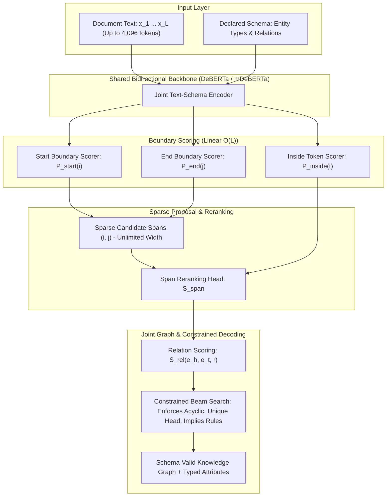

# Seri GLiNER 2.5: Arsitektur Prediksi Batas & Ekstraksi Terstruktur Berkendala

> [!abstract] Definisi
> **GLiNER 2.5** (dirilis oleh Fastino AI / Mary Newhauser & Urchade Zaratiana, Agustus 2026) adalah arsitektur model ekstraksi informasi dan klasifikasi terstruktur non-autoregresif berbasis transformer dwiarah (*bidirectional encoder*). GLiNER 2.5 menggantikan mekanisme *span enumeration* tradisional dengan **prediksi batas (boundary prediction)**, memungkinkan ekstraksi entitas dengan panjang tak terbatas (*unlimited span length*), dekoding graf pengetahuan entitas-relasi secara *joint*, serta klasifikasi dengan kendala logika ketat dalam satu *forward pass* linear $O(L)$.

---

## 1. Intuisi & Latar Belakang

Model GLiNER generasi awal (GLiNER 1 & 2; Zaratiana et al., 2023/2024) merevolusi *Named Entity Recognition* (NER) dengan memperlakukan ekstraksi sebagai pencocokan kemiripan representasi antara teks dan tipe entitas. Namun, GLiNER 1 dan 2 memiliki kelemahan struktural mendasar: **Enumerasi Span (Span Enumeration)**.

### Hambatan Enumerasi Span
Untuk mengekstrak entitas dari teks sepanjang $L$ token, model harus membuat dan menghitung skor untuk setiap kemungkinan pasangan indeks awal $i$ dan akhir $j$:
$$\text{Jumlah Kandidat} \approx L \cdot W$$
di mana $W$ adalah lebar maksimum span (biasanya dibatasi $W \approx 12$ kata).

Akibatnya:
1. **Entitas Panjang Menjadi Tak Terlihat:** Klausa hukum sepanjang 40 kata, alamat surat lengkap, atau kutipan akademik yang melebihi 12 kata tidak dapat diekstrak sama sekali.
2. **Beban Komputasi Kuadratik:** Kebutuhan memori melonjak drastis sehingga teks panjang tidak dapat diproses dalam satu *forward pass*.

### Solusi GLiNER 2.5: Prediksi Batas (Boundary Prediction)
Alih-alih membuat daftar semua kombinasi span, GLiNER 2.5 memprediksi **di mana sebuah entitas dimulai dan di mana ia berakhir**:
- Berapa peluang token $i$ adalah awal entitas? ($P_{\text{start}}$)
- Berapa peluang token $j$ adalah akhir entitas? ($P_{\text{end}}$)

Karena model hanya menilai batas awal dan batas akhir secara independen sebelum memasangkannya melalui *sparse proposal*, entitas sepanjang 50 kata membutuhkan biaya komputasi yang **persis sama** dengan entitas 2 kata.

> [!quote] Mary Newhauser & Urchade Zaratiana (Fastino AI)
> "The architecture replaces span enumeration with boundary prediction, scoring entity start and end positions directly, so inference scales linearly with document length. And the training data was generated with the Fastino Data Agent... covering task combinations that no public dataset does."
> — [Fastino AI Research Blog: Introducing GLiNER2.5 (2026)](https://fastino.ai/blog/gliner2-5-span-free-information-extraction)

---

## 2. Lima Kapabilitas Baru GLiNER 2.5

1. **Ekstraksi Konteks Panjang Dokumen Penuh:** Memproses urutan hingga 4.096 token secara langsung tanpa pemotongan (*chunking*).
2. **Panjang Span Tak Terbatas (*Unlimited Span Length*):** Menghilangkan batasan lebar span maksimum, memungkinkan penangkapan seluruh klausa hukum atau judul buku panjang.
3. **Ekstraksi Bersama Entitas & Relasi (*Joint IE for Knowledge Graphs*):** Entitas dan relasi didekode secara serentak sehingga relasi yang terbentuk dijamin terhubung ke entitas yang benar-benar ada dalam hasil ekstraksi.
4. **Klasifikasi Berkendala (*Constrained Classification*):** Mendukung deklarasi aturan logika (`C.implies`, `C.excludes`) sehingga kombinasi label yang kontradiktif tidak mungkin dihasilkan.
5. **Atribut Span (*Span Attributes*):** Melampirkan label kualifikasi (seperti sentimen atau negasi) langsung pada span yang diekstrak dalam satu lintasan komputasi.

---

## 3. Formalisme Matematis

### 3.1 Arsitektur Prediksi Batas

Diberikan teks input $X = (x_1, x_2, \dots, x_L)$ dan kumpulan deskripsi tipe entitas $Q = (q_1, q_2, \dots, q_K)$.
Keduanya digabungkan dan dienkode melalui encoder transformer dwiarah bersama:

$$H = \text{Encoder}([Q; \text{[SEP]}; X]) \in \mathbb{R}^{(|Q| + L) \times d}$$

Misalkan $h_t$ adalah representasi token teks ke-$t$, dan $e_k$ adalah representasi query tipe entitas ke-$k$. Kepala batas menghitung tiga probabilitas:

#### 1. Probabilitas Batas Awal (Start Boundary)
$$P_{\text{start}}(i \mid q_k) = \sigma\left( \mathbf{W}_s [h_i \odot e_k] + b_s \right)$$

#### 2. Probabilitas Batas Akhir (End Boundary)
$$P_{\text{end}}(j \mid q_k) = \sigma\left( \mathbf{W}_e [h_j \odot e_k] + b_e \right)$$

#### 3. Probabilitas Token Internal (Inside Token)
$$P_{\text{inside}}(t \mid q_k) = \sigma\left( \mathbf{W}_m [h_t \odot e_k] + b_m \right), \quad i \le t \le j$$

#### Tahap Sparse Proposal & Reranking
Model memilih himpunan indeks awal teratas $\{i\}$ dan indeks akhir teratas $\{j\}$ yang melampaui ambang batas dinamis $\tau_{\text{thresh}}$, lalu membentuk pasangan kandidat $(i, j)$ dengan $i \le j$ tanpa batasan lebar $|j - i + 1|$.

Kandidat span kemudian dinilai oleh kepala perankingan (*reranking head*):

$$S_{\text{span}}(i, j, k) = \text{MLP}\left( [h_i; \, h_j; \, h_{[i:j]}^{\text{pool}}; \, e_k] \right)$$

Komputasi berskala linear $O(L)$ terhadap panjang teks untuk anggaran kandidat tetap.

---

### 3.2 Dekoding Graf Pengetahuan Bersama (Joint KG Decoding)

Pada GLiNER 2, relasi diekstrak secara terpisah sehingga sering memunculkan referensi gantung (*dangling reference*) atau siklus tak valid.

GLiNER 2.5 memformulasikan ekstraksi entitas dan relasi sebagai satu masalah optimasi graf terpadu di bawah kendala skema pengguna:

$$\mathcal{G}^* = \arg\max_{\mathcal{G} \subseteq \mathcal{E} \times \mathcal{R} \times \mathcal{E}} \left( \sum_{e \in \mathcal{E}(\mathcal{G})} S_{\text{span}}(e) + \sum_{(e_h, r, e_t) \in \mathcal{R}(\mathcal{G})} S_{\text{rel}}(e_h, e_t, r) \right)$$

$$\text{dengan kendala:} \quad \begin{cases}
e_h \ne e_t, & \text{jika } \texttt{no\_self\_loops} = \text{True} \\
|\{e_t : (e_h, r, e_t) \in \mathcal{G}\}| \le 1, & \text{jika } \texttt{unique\_head} = \text{True} \\
\text{Cycle}(\mathcal{G}) = \emptyset, & \text{jika } \texttt{acyclic} = \text{True}
\end{cases}$$

Dekoding dieksekusi menggunakan **Constrained Beam Search**: kandidat kombinasi yang melanggar aturan logika dieliminasi saat ekspansi beam, sehingga graf yang dihasilkan **valid secara konstruksi**.

---

### 3.3 Klasifikasi Berkendala (Constrained Classification)

Untuk mencegah kontradiksi antar tugas klasifikasi (misal: sistem guardrail memberi label `"aman"` sekaligus mendeteksi `"harm_type: injection"`), GLiNER 2.5 mengintegrasikan kendala boolean langsung ke ruang dekoding:

Misalkan $y_A \in \mathcal{C}_A$ dan $y_B \in \mathcal{C}_B$. Aturan implikasi dan eksklusi didefinisikan:
- **Implikasi:** $(y_A = a) \implies (y_B = b)$
- **Eksklusi:** $(y_A = a) \implies (y_B \ne c)$

Jika penugasan gabungan $(a, c)$ melanggar aturan eksklusi, probabilitas gabungannya dipaksa ke nol:
$$P(y_A = a, y_B = c) = 0$$

---

## 4. Diagram Arsitektur GLiNER 2.5



---

## 5. Benchmark & Hasil Empiris

Hasil evaluasi zero-shot pada 16 benchmark publik dibandingkan dengan GLiNER 2:

| Benchmark / Tugas | GLiNER2.5 Multi (0.3B) | GLiNER2.5 Base (0.2B) | GLiNER2 Multi | GLiNER2 Base | Peningkatan GLiNER 2.5 |
| :--- | :--- | :--- | :--- | :--- | :--- |
| **XNLI (Natural Language Inference)** | **62.30 F1** | 54.49 F1 | 37.55 F1 | 49.01 F1 | **+24.75 F1** (Multi) |
| **Few-NERD (Zero-Shot General NER)** | 52.37 F1 | **55.14 F1** | 51.49 F1 | 47.22 F1 | **+7.92 F1** (Base) |
| **RONEC (Romanian Zero-Shot Multilingual)**| **40.13 F1** | 37.01 F1 | 38.86 F1 | 31.55 F1 | **+1.27 F1** (Multi) |
| **Rata-rata Klasifikasi (16 Tugas)** | **72.44 F1** | 69.86 F1 | 70.32 F1 | 68.89 F1 | **+2.12 F1** |
| **Rata-rata Ekstraksi (16 Tugas)** | 46.40 F1 | 45.88 F1 | **47.56 F1** | 43.14 F1 | Mempertahankan kualitas |

---

## 6. Contoh Minimal Kode: GLiNER 2.5 SDK

Contoh ekstraksi entitas-relasi *joint* dengan batasan skema dan atribut span:

```python
from gliner2.joint_ie import JointIE, JointIEConfig
from gliner2 import ClassificationSchema, C

# 1. Muat checkpoint GLiNER 2.5 Multilingual
joint_model = JointIE.from_pretrained("fastino/gliner2.5-multi-v1")

# 2. Definisikan skema entitas, relasi, dan batasan logika
schema = (
    joint_model.create_schema()
    .entities(["person", "organization", "location", "legal_clause"])
    .relation("works_for", "person", "organization", unique_head=True)
    .relation("located_in", "organization", "location", unique_head=True)
    .no_self_loops()
)

# 3. Teks pengujian (termasuk klausa hukum panjang)
text = (
    "Sundar Pichai leads Google in Mountain View. "
    "Under Section 14.2, the indemnification obligations shall survive any termination or expiration of this Agreement."
)

# 4. Ekstraksi dalam satu forward pass dengan Constrained Beam Search
result = joint_model.extract(text, schema, config=JointIEConfig(optimizer="beam", beam_size=16))

print("=== ENTITAS TEREKSTRAK ===")
for entity in result.entities:
    print(f"[{entity.label}] '{entity.text}' (Index: {entity.start}-{entity.end}, Conf: {entity.confidence:.2f})")

print("\n=== RELASI GRAF TEREKSTRAK ===")
for rel in result.relations:
    head = result.entity(rel.head)
    tail = result.entity(rel.tail)
    print(f"{head.text} --[{rel.type}]--> {tail.text} (Conf: {rel.confidence:.2f})")

# Output:
# Sundar Pichai --[works_for]--> Google (Conf: 0.89)
# Google --[located_in]--> Mountain View (Conf: 0.95)
# [legal_clause] 'the indemnification obligations shall survive any termination or expiration of this Agreement' (Conf: 0.91)
```

---

## Referensi & Hubungan

- Catatan Terkait:
  - [[00-index-rlcd-and-system-one|Index Utama RLCD]]
  - [[01-rlcd-theory-and-formalism|Teori & Matematika RLCD]]
  - [[03-typesafe-jev-architecture|Arsitektur TypeSafe Jev]]
  - [[04-laya-decision-engine|Laya Decision Engine]]
- Sumber Eksternal:
  - [Fastino AI: Introducing GLiNER 2.5 Blog Post](https://fastino.ai/blog/gliner2-5-span-free-information-extraction)
  - [Zaratiana et al. (2024): GLiNER NAACL Paper](https://aclanthology.org/2024.naacl-long.300)
  - [Fastino Hugging Face Hub: fastino/gliner2.5-multi-v1](https://huggingface.co/fastino/gliner2.5-multi-v1)
