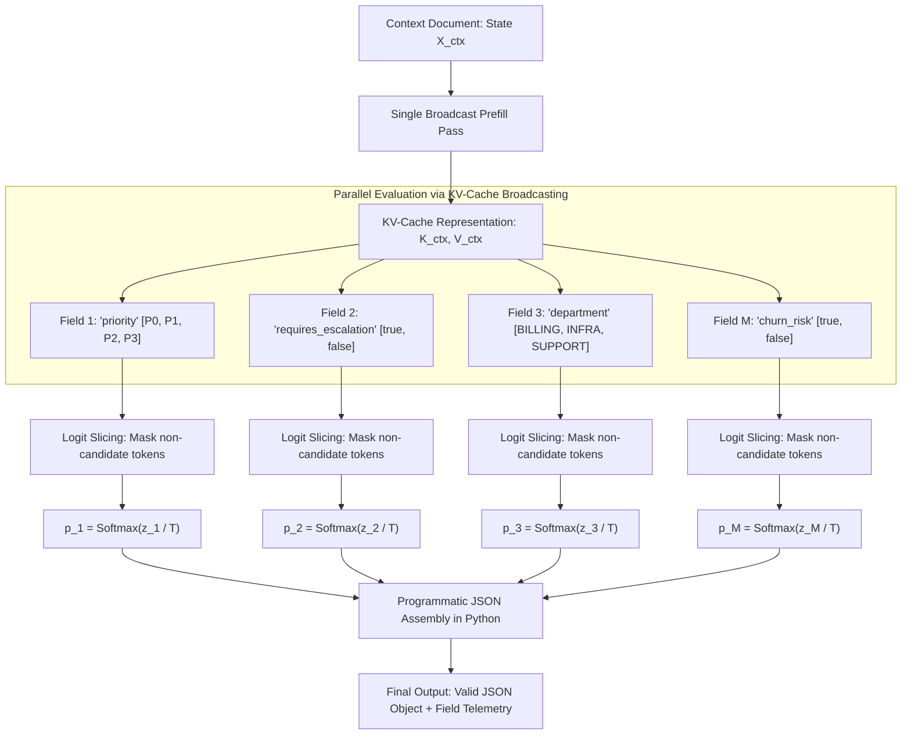

# Implementasi Parallel Constrained Decoding: Qwen-2.5-RLCD & LFM-2.5-RLCD

> [!abstract] Definisi
> **Parallel Constrained Decoding** adalah teknik inferensi non-autoregresif yang memanfaatkan bobot model bahasa dasar (*pretrained / fine-tuned LLM*) untuk mengevaluasi seluruh atribut skema JSON secara simultan. Dengan melakukan **satu kali prefill konteks (KV-cache broadcasting)** dan pemotongan logit sub-kosakata (*sub-vocabulary logit slicing*), teknik ini memangkas latensi hingga $5.6\times\text{--}63\times$ dibandingkan generasi autoregresif dengan **jaminan validitas skema 100%**.

Dua implementasi open-source terkemuka yang menerapkan prinsip ini adalah:
1. **`harshatheg/Qwen-2.5-1B-RLCD`**: Mesin inferensi berkecepatan tinggi berbasis framework MLX untuk Apple Silicon (M1–M4).
2. **`notnotsamuel/LFM2.5-350M-RLCD`**: Implementasi paralel pada arsitektur hybrid Liquid Foundation Model (LFM2.5-350M).

---

## 1. Intuisi & Masalah Dekoding Autoregresif

Saat model bahasa generatif diminta menghasilkan data JSON terstruktur (misalnya melalui JSON mode atau regex grammar), dekoder harus menghasilkan token satu per satu:

```
[Prompt Konteks] -> "{" -> "\n" -> " " -> "urgensi" -> ":" -> " " -> "TINGGI" -> ...
```

Proses ini membutuhkan antara $150$ hingga $500$ *forward pass* sekuensial. Setiap token membebani memori GPU dan memperpanjang latensi.

### Pendekatan Parallel Constrained Decoding
Dalam ekstraksi dan perutean terstruktur, nilai setiap field umumnya berasal dari himpunan terbatas (*bounded candidate set*, misal: boolean `true/false` atau enum kategori `["billing", "technical", "sales"]`).

Daripada membiarkan model "mengetik" tanda kurung kurawal, tanda kutip, dan spasi:
1. **Prefill Sekali:** Dokumen konteks dan deskripsi field dienkode satu kali ke dalam KV-cache.
2. **Broadcast KV-Cache:** KV-cache tersebut disiarkan (*broadcast*) ke seluruh $M$ field skema secara paralel.
3. **Logit Slicing:** Untuk setiap field, kita hanya mengevaluasi logit token kandidat yang diizinkan dalam skema, memotong 99.9% kosakata lainnya.
4. **Assembling JSON Programatik:** Output JSON disusun langsung menggunakan modul Python (`json.dumps`), menjamin 100% bebas dari kesalahan sintaksis JSON.

> [!quote] Model Card: harshatheg/Qwen-2.5-1B-RLCD
> "Parallel Constrained Decoding evaluates multi-field JSON schemas simultaneously rather than generating tokens sequentially. On an Apple Silicon M4 Max, it delivers 5.6x to 7.0x latency reductions compared to standard autoregressive decoding with 100% schema validity and calibrated field-level confidence scores."
> — [Hugging Face: harshatheg/Qwen-2.5-1B-RLCD (2026)](https://huggingface.co/harshatheg/Qwen-2.5-1B-RLCD)

---

## 2. Formalisme Matematis

### 2.1 KV-Cache Broadcasting & Sub-Vocabulary Logit Slicing

Misalkan $X_{\text{ctx}} = (x_1, \dots, x_N)$ adalah token konteks dokumen. Satu kali proses prefill menghasilkan status KV-cache:

$$\mathcal{K}_{\text{ctx}}, \mathcal{V}_{\text{ctx}} = \text{TransformerPrefill}(X_{\text{ctx}})$$

Diberikan skema target dengan $M$ field independen $\{f_1, \dots, f_M\}$. Setiap field $f_m$ memiliki kandidat nilai yang diizinkan $\mathcal{C}_m = \{c_1^{(m)}, \dots, c_{K_m}^{(m)}\}$ di mana setiap kandidat terpetakan ke token id dalam kosakata $\mathcal{V}$.

Untuk setiap field $f_m$, kita menghitung representasi tersembunyi akhir $h_m$ dengan mengondisikannya pada $\mathcal{K}_{\text{ctx}}, \mathcal{V}_{\text{ctx}}$. Logit untuk seluruh kosakata adalah:

$$z = \mathbf{W}_{\text{vocab}} h_m + b_{\text{vocab}} \in \mathbb{R}^{|\mathcal{V}|}$$

Kita melakukan **logit slicing** hanya pada token kandidat yang valid $\mathcal{C}_m \subset \mathcal{V}$:

$$z_i^{(m)} = z\left[ \text{token\_id}(c_i^{(m)}) \right], \quad \forall c_i^{(m)} \in \mathcal{C}_m$$

Probabilitas terkalibrasi dihitung melalui Softmax atas irisan kandidat tersebut:

$$P(c_i^{(m)} \mid X_{\text{ctx}}) = \frac{\exp\left( z_i^{(m)} / T \right)}{\sum_{j=1}^{|\mathcal{C}_m|} \exp\left( z_j^{(m)} / T \right)}$$

Pilihan optimal untuk field $f_m$:

$$\hat{c}^{(m)} = \arg\max_{c_i \in \mathcal{C}_m} P(c_i^{(m)} \mid X_{\text{ctx}})$$

---

### 2.2 Perbandingan Latensi Matematis

Latensi dekoding autoregresif bertumbuh secara linear terhadap panjang token output $T_{\text{out}}$:

$$T_{\text{autoregressive}} = t_{\text{prefill}}(N) + \sum_{t=1}^{T_{\text{out}}} t_{\text{decode}}(t)$$

Sementara pada Parallel Constrained Decoding, karena seluruh $M$ field dievaluasi secara simultan dalam satu langkah paralel:

$$T_{\text{parallel}} = t_{\text{prefill}}(N) + \max_{m \in \{1,\dots,M\}} t_{\text{eval}}(f_m) \approx t_{\text{prefill}}(N) + O(1)$$

Karena $T_{\text{out}} \ge 150$ token pada JSON skema besar, rasio percepatan mencapai:

$$\text{Speedup} = \frac{T_{\text{autoregressive}}}{T_{\text{parallel}}} \approx 5\times - 60\times$$

---

## 3. Diagram Alur Parallel Constrained Decoding



---

## 4. Benchmark Empiris: Apple Silicon & GPU Server

### 4.1 Benchmark `harshatheg/Qwen-2.5-1B-RLCD` (Apple Silicon M4 Max)

Diuji menggunakan framework MLX pada macOS Sequoia:

| Skenario | Jumlah Field | Baseline Autoregresif | Parallel Constrained | Peningkatan Kecepatan (*Speedup*) | Validitas Sintaksis JSON |
| :--- | :--- | :--- | :--- | :--- | :--- |
| **Fintech Fraud Routing** | 4 field | 420 ms (120 tok/s) | **75 ms** | **5.6x** | 100% Dijamin |
| **Code Security Audit** | 4 field | 380 ms (125 tok/s) | **68 ms** | **5.6x** | 100% Dijamin |
| **High-Cardinality Tariff** | 1 field (255 pilihan) | 500 ms (118 tok/s) | **89 ms** | **5.6x** | 100% Dijamin |
| **Enterprise Support Triage**| 28 field | 1.900 ms (130 tok/s)| **270 ms** | **7.0x** | 100% Dijamin |

---

### 4.2 Benchmark `notnotsamuel/LFM2.5-350M-RLCD` (Liquid AI LFM)

Diuji pada satu input sintetis dengan 28 field boolean menggunakan precision FP16:

| Perangkat Keras | Mean Terkendala (*Constrained*) | Mean Autoregresif | Percepatan (*Speedup*) | Validitas Skema | Akurasi Field |
| :--- | :--- | :--- | :--- | :--- | :--- |
| **Apple M2 Max** | **393.20 ms** | 3.326.95 ms | **8.46x** | 100% / 100% | 60.7% / 53.6% |
| **NVIDIA L40S** | **54.12 ms** | 3.404.48 ms | **62.91x** | 100% / 100% | 64.3% / 53.6% |
| **NVIDIA H100** | **43.76 ms** | 2.586.97 ms | **59.12x** | 100% / 100% | 60.7% / 53.6% |

> [!warning] Nuansa Kritis: Validitas JSON $\ne$ Kebenaran Keputusan
> Seperti dicatat pada model card `LFM2.5-350M-RLCD`:
> "Valid JSON does not mean correct answers: neither method produced a fully correct 28-field object. The constrained method guarantees structure through programmatic assembly, not model accuracy."
> Jaminan tipe data dan struktur berasal dari perakitan kode program, bukan kualitas penalaran model dasar.

---

## 5. Contoh Minimal Kode: Penggunaan Engine Terkendala

Implementasi inferensi terstruktur menggunakan `rlcd.engine` (pada model LFM/Qwen):

```python
import json
from rlcd.engine import Engine

# 1. Definisikan skema JSON dengan batasan ketat (flat object, enum/boolean)
schema = {
    "type": "object",
    "properties": {
        "department": {
            "type": "string",
            "description": "Target handling team",
            "enum": ["billing", "technical", "sales", "legal"]
        },
        "urgent": {
            "type": "boolean",
            "description": "True only if immediate action is required"
        },
        "refund_requested": {
            "type": "boolean",
            "description": "Whether the customer requests a refund"
        }
    },
    "required": ["department", "urgent", "refund_requested"],
    "additionalProperties": False
}

# 2. Inisialisasi Engine (Apple Silicon menggunakan 'mps', NVIDIA menggunakan 'cuda')
engine = Engine(device="mps", dtype="float16")

# 3. Pesan input (State)
message = "I was charged twice on invoice #9012. Please refund the duplicate charge today. No rush on other items."

# 4. Inferensi paralel satu langkah (Single Forward Pass)
result = engine.constrained(message, schema)

print("=== HASIL JSON TERSTRUKTUR (100% VALID) ===")
print(result["text"])

# Parse langsung tanpa khawatir syntax error
data = json.loads(result["text"])
print(f"Departemen: {data['department']}")
print(f"Urgensi   : {data['urgent']}")
print(f"Refund    : {data['refund_requested']}")

# 5. Nilai probabilitas tiap kandidat
print("\n=== SKOR PROBABILITAS KANDIDAT ===")
print(result["scores"])
```

---

## Referensi & Hubungan

- Catatan Terkait:
  - [[00-index-rlcd-and-system-one|Index Utama RLCD]]
  - [[01-rlcd-theory-and-formalism|Teori & Matematika RLCD]]
  - [[03-typesafe-jev-architecture|Arsitektur TypeSafe Jev]]
  - [[04-laya-decision-engine|Laya Decision Engine]]
  - [[05-gliner-2-5-boundary-architecture|Seri GLiNER 2.5]]
- Sumber Eksternal:
  - [Hugging Face Hub: harshatheg/Qwen-2.5-1B-RLCD](https://huggingface.co/harshatheg/Qwen-2.5-1B-RLCD)
  - [Hugging Face Hub: notnotsamuel/LFM2.5-350M-RLCD](https://huggingface.co/notnotsamuel/LFM2.5-350M-RLCD)
  - [Liquid AI: Liquid Foundation Models](https://www.liquid.ai/)
