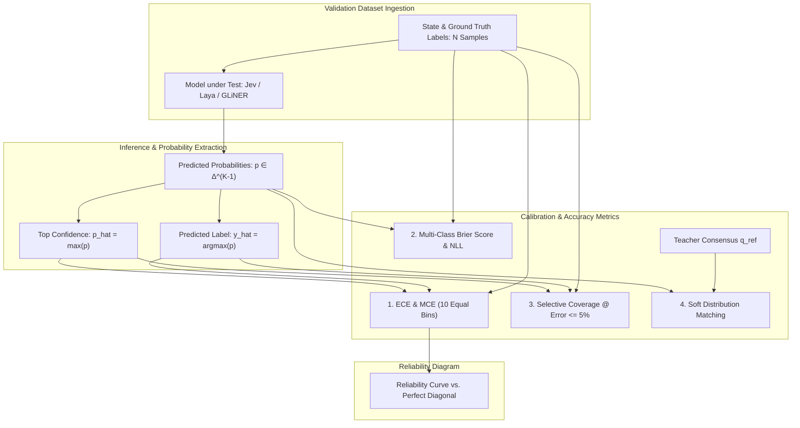

# Metodologi Evaluasi, Metrik Kalibrasi & Analisis Benchmark RLCD

> [!abstract] Definisi
> **Metodologi Evaluasi RLCD** adalah kerangka kerja pengujian kuantitatif untuk model keputusan *System 1* yang berfokus pada **ketepatan probabilitas epistemik (calibration)** dan **keandalan otomatisasi selektif (selective automation)**, alih-alih mengukur kefasihan generasi teks (seperti BLEU, ROUGE, atau Win-Rate LLM-as-a-judge).

---

## 1. Intuisi

Mengapa pengujian model keputusan berbeda secara radikal dari pengujian LLM percakapan?

Pada chatbot (System 2), metrik evaluasi utama adalah *Human Preference Win-Rate* (seperti LMSYS Chatbot Arena). Jika sebuah model berbicara fasih, sopan, dan persuasif, manusia memberinya skor tinggi meskipun akurasi faktualnya tidak sempurna.

Sebaliknya, pada model keputusan yang tertanam dalam pipeline software (System 1):
1. **Akurasi saja tidak cukup.** Sebuah model dengan akurasi 80% yang selalu mengklaim confidence 100% adalah model yang berbahaya untuk otomatisasi.
2. **Kejujuran ketidakpastian adalah aset berharga.** Model dengan akurasi 80% yang mampu menandai 20% kasus yang salah dengan *confidence rendah* memungkinkan software melakukan **otomatisasi selektif**: mengeksekusi 80% kasus secara instan tanpa manusia, dan mengeskalasikan 20% kasus ambigu ke kurasi manual.

```
                          Evaluasi Klasik LLM vs. Evaluasi RLCD
┌──────────────────────────────────────────────┐  ┌──────────────────────────────────────────────┐
│             Evaluasi LLM Generatif           │  │             Evaluasi RLCD / System 1         │
├──────────────────────────────────────────────┤  ├──────────────────────────────────────────────┤
│ • Fokus: Kefasihan bahasa, koherensi teks    │  │ • Fokus: Kalibrasi probabilitas, reliabilitas│
│ • Metrik: Win-Rate, MMLU, MT-Bench           │  │ • Metrik: ECE, Brier Score, Coverage @ ≤5%   │
│ • Evaluator: Rater manusia / LLM-as-a-Judge   │  │ • Evaluator: Verifikasi hasil / Konsensus    │
│ • Toleransi: Jawaban ambigu dapat dimaafkan  │  │ • Toleransi: Probabilitas salah = denda besar│
└──────────────────────────────────────────────┘  └──────────────────────────────────────────────┘
```

---

## 2. Formalisme Matematis Metrik Evaluasi

### 2.1 Expected Calibration Error (ECE) & Maximum Calibration Error (MCE)

Diberikan kumpulan data validasi berisi $N$ sampel keputusan. Misalkan untuk setiap sampel $i$, model menghasilkan prediksi kelas $\hat{y}_i = \arg\max_k p_{ik}$ dengan kepercayaan $\hat{p}_i = \max_k p_{ik}$.

Seluruh sampel dikelompokkan ke dalam $M$ bin interval $[0, 1]$ (biasanya $M = 10$ atau $15$):

$$B_m = \left\{ i \in \{1, \dots, N\} : \hat{p}_i \in \left( \frac{m-1}{M}, \frac{m}{M} \right] \right\}$$

Akurasi empiris dan rata-rata confidence dalam bin $B_m$:

$$\text{acc}(B_m) = \frac{1}{|B_m|} \sum_{i \in B_m} \mathbf{1}(\hat{y}_i = y_i), \quad \text{conf}(B_m) = \frac{1}{|B_m|} \sum_{i \in B_m} \hat{p}_i$$

**Expected Calibration Error (ECE)** mengukur rata-rata berbobot deviasi kalibrasi:

$$\text{ECE} = \sum_{m=1}^M \frac{|B_m|}{N} \left| \text{acc}(B_m) - \text{conf}(B_m) \right|$$

**Maximum Calibration Error (MCE)** mengukur skenario terburuk di seluruh bin:

$$\text{MCE} = \max_{m \in \{1,\dots,M\}} \left| \text{acc}(B_m) - \text{conf}(B_m) \right|$$

Semakin kecil nilai ECE dan MCE (mendekati $0.0$), semakin terkalibrasi model tersebut.

---

### 2.2 Multi-Class Brier Score & Dekomposisi Murphy

Brier Score mengukur ketepatan probabilitas kuadratik:

$$\text{BS} = \frac{1}{N} \sum_{i=1}^N \sum_{k=1}^K (p_{ik} - y_{ik})^2$$

Berdasarkan teorema **Murphy (1973)**:

$$\text{BS} = \underbrace{\sum_{m=1}^M \frac{|B_m|}{N} (\text{conf}(B_m) - \text{acc}(B_m))^2}_{\text{Reliability (Calibration Error)}} - \underbrace{\sum_{m=1}^M \frac{|B_m|}{N} (\text{acc}(B_m) - \bar{y})^2}_{\text{Resolution}} + \underbrace{\bar{y}(1 - \bar{y})}_{\text{Uncertainty}}$$

Model yang ideal meminimalkan *Reliability* hingga $0$ dan memaksimalkan *Resolution*.

---

### 2.3 Klasifikasi Selektif & Coverage pada Toleransi Error Tertentu

Dalam otomatisasi software, metrik yang paling relevan secara komersial adalah:
**Berapa persen volume tugas yang dapat diotomatisasi secara penuh dengan tingkat kesalahan di bawah ambang batas tertentu (misal: $\le 5\%$)?**

Misalkan $\tau \in [0, 1]$ adalah ambang batas confidence.
1. **Cakupan Otomatisasi (Coverage):**
   $$\Phi(\tau) = \frac{1}{N} \sum_{i=1}^N \mathbf{1}(\text{confidence}_i \ge \tau)$$
2. **Akurasi Selektif (Selective Accuracy):**
   $$\text{Acc}(\tau) = \frac{\sum_{i=1}^N \mathbf{1}(\hat{y}_i = y_i) \mathbf{1}(\text{confidence}_i \ge \tau)}{\sum_{i=1}^N \mathbf{1}(\text{confidence}_i \ge \tau)}$$
3. **Tingkat Kesalahan Selektif (Selective Risk):**
   $$\text{Risk}(\tau) = 1 - \text{Acc}(\tau)$$

**Metrik Kunci:**
$$\text{Coverage}_{@\text{Risk} \le 5\%} = \max \left\{ \Phi(\tau) : \text{Risk}(\tau) \le 0.05 \right\}$$

---

### 2.4 Evaluasi Konsensus Alur Kerja (Workflow Consensus Evals)

TypeSafe AI memperkenalkan paradigma evaluasi baru yang disebut **Workflow Evals**:
Alih-alih menguji satu pertanyaan terisolasi, pengujian dilakukan pada graf komputasi alur kerja software nyata (misal: triage faktur, audit sekuritas, perutean agen).

Karena tidak semua keputusan memiliki *ground truth* biner yang absolut, distribusi probabilitas referensi $\mathbf{q}_{\text{ref}}$ dibangun melalui konsensus ansambel model frontier terbesar (misal: rata-rata probabilitas GPT-6 Astra dan Fable 5.1).

Evaluasi mengukur dua metrik:
1. **Akurasi Argmax:** Persentase kesesuaian keputusan teratas.
2. **Akurasi Lunak (Soft Accuracy / Distribution Matching):**
   $$\text{SoftAcc} = 1 - \frac{1}{2} \sum_{k=1}^K |p_k - q_{\text{ref}, k}|$$

---

## 3. Sintesis Benchmark Komprehensif

Tabel berikut mengonsolidasikan data empiris dari publikasi TypeSafe AI, benchmark independen AbdelStark (`jev-benchmarks`), LavX News, dan model card Convai Laya:

| Benchmark / Metrik | TypeSafe Jev 1.13.0 | Convai Laya (Routed) | Fastino GLiNER2.5 | Frontier LLM (GPT-4o / Claude 3.5) |
| :--- | :---: | :---: | :---: | :---: |
| **`typed-decisions` (2.000 keputusan)** | 0.727 | **0.766** | N/A | 0.735 (*Teacher ceiling*) |
| **AG News (4 label)** | 0.910 | **0.950** | 0.700 | 0.930 |
| **Banking77 (72 vs 77 label)** | **0.870** | 0.425 | 0.610 | 0.850 |
| **DAIR Emotion (6 label)** | 0.480 | **0.595** | 0.440 | 0.520 |
| **XNLI (Natural Language Inference)** | N/A | 0.860 (Eng) / 0.731 (Multi) | 0.623 (F1) | 0.880 |
| **Expected Calibration Error (ECE)** | 0.144 | **0.081** | ~0.210 | 0.280–0.420 (*Overconfident*) |
| **Coverage @ Error $\le 5\%$ (AG News)**| **0.830** | ~0.850 | 0.240 | 0.410 |
| **Coverage @ Error $\le 5\%$ (Banking77)**| **0.860** | 0.220 | 0.270 | 0.510 |
| **Latensi Tunggal (Single Question)** | 236–276 ms | **32.8 ms** | 44 ms | 1.500–4.000 ms |
| **Latensi Batched (10 Pertanyaan)** | ~250 ms | **7.2 ms / q** | ~15 ms / q | 3.000–15.000 ms |
| **Biaya Input / 1M Token** | $0.042 | **$0.00 (Self-hosted)** | **$0.00 (Self-hosted)** | $2.50–$3.00 |
| **Biaya Output Token** | **$0.00 (Free)** | **$0.00 (Free)** | **$0.00 (Free)** | $10.00–$15.00 |
| **Tingkat Kesalahan Skema** | **0.0% (Dijamin)** | **0.0% (Dijamin)** | **0.0% (Dijamin)** | 2.0%–8.0% |

---

## 4. Analisis Kegagalan & Model Jaggedness

Meskipun model RLCD System 1 unggul dalam kecepatan dan kalibrasi, terdapat beberapa batasan struktural (*jagged edges*) yang harus diperhatikan:

### 1. Bottleneck Kardinalitas Tinggi ($K > 20$) pada Encoder Kecil
- **Fenomena:** Pada dataset Banking77 (77 label), akurasi Laya anjlok menjadi 0.425, sementara Jev bertahan di 0.870.
- **Penyebab:** Pada model encoder dengan batas anggaran token kepala (`head_max_len = 192` atau $256$), 77 opsi label harus berbagi ruang token, sehingga setiap opsi hanya mendapatkan $3\text{--}4$ token. Representasi teks label menjadi terdistorsi.
- **Solusi Rekayasa:** Gunakan hierarki dua tahap (*coarse-to-fine hierarchical classification*): klasifikasikan terlebih dahulu ke dalam 5 kategori besar, kemudian lakukan pemilihan lanjutan pada kategori yang terpilih.

### 2. Script Collapse pada Model Non-Multilingual
- **Fenomena:** Model yang dilatih hanya pada teks alfabet Latin mengalami kegagalan fatal pada skrip non-Latin (misal: akurasi 0% pada teks Khmer), namun **tetap melaporkan confidence 95.2%**.
- **Solusi Rekayasa:** Selalu tempatkan router deteksi skrip Unicode sub-milidetik di depan model (seperti pada [[04-laya-decision-engine|Laya Router]]).

### 3. Keruntuhan Probabilitas pada Kasus Ambigu (DAIR Emotion)
- **Fenomena:** Pada dataset emosi (DAIR Emotion), Jev memberikan probabilitas $0.0$ pada label yang benar pada 16% sampel. Jika sistem menerapkan aturan keras `if p == 0: reject`, sistem dapat memblokir kasus yang sah.

---

## 5. Visual Alur Evaluasi RLCD



---

## 6. Contoh Minimal Kode: Script Evaluasi Kalibrasi

Skrip Python mandiri untuk menghitung ECE, Brier Score, dan Coverage @ Error $\le 5\%$:

```python
import numpy as np

def evaluate_calibration(probs: np.ndarray, targets: np.ndarray, n_bins: int = 10):
    """Menghitung akurasi, ECE, Brier score, dan selective coverage."""
    confidences = np.max(probs, axis=1)
    predictions = np.argmax(probs, axis=1)
    accuracies = (predictions == targets).astype(float)
    
    # 1. Akurasi Global & Brier Score
    overall_acc = np.mean(accuracies)
    num_classes = probs.shape[1]
    one_hot_targets = np.eye(num_classes)[targets]
    brier_score = np.mean(np.sum((probs - one_hot_targets) ** 2, axis=1))
    
    # 2. Expected Calibration Error (ECE)
    bin_boundaries = np.linspace(0, 1, n_bins + 1)
    ece = 0.0
    
    for i in range(n_bins):
        bin_lower = bin_boundaries[i]
        bin_upper = bin_boundaries[i + 1]
        
        in_bin = (confidences > bin_lower) & (confidences <= bin_upper)
        bin_size = np.sum(in_bin)
        
        if bin_size > 0:
            bin_acc = np.mean(accuracies[in_bin])
            bin_conf = np.mean(confidences[in_bin])
            ece += (bin_size / len(targets)) * np.abs(bin_acc - bin_conf)
            
    # 3. Selective Coverage pada Error <= 5% (Akurasi >= 95%)
    thresholds = np.linspace(0.0, 1.0, 101)
    best_coverage = 0.0
    optimal_tau = 1.0
    
    for tau in thresholds:
        accepted = confidences >= tau
        cov = np.mean(accepted)
        if cov > 0:
            sel_acc = np.mean(accuracies[accepted])
            sel_error = 1.0 - sel_acc
            if sel_error <= 0.05:
                best_coverage = cov
                optimal_tau = tau
                break  # Ambang batas terendah yang memenuhi syarat
                
    return {
        "accuracy": overall_acc,
        "brier_score": brier_score,
        "ece": ece,
        "coverage_at_5pct_error": best_coverage,
        "optimal_threshold": optimal_tau
    }

# Minimal Synthetic Test
np.random.seed(42)
N, K = 1000, 4
synthetic_targets = np.random.randint(0, K, size=N)
synthetic_logits = np.random.randn(N, K)
synthetic_logits[np.arange(N), synthetic_targets] += 2.0  # Tambah sinyal
synthetic_probs = np.exp(synthetic_logits) / np.sum(np.exp(synthetic_logits), axis=1, keepdims=True)

metrics = evaluate_calibration(synthetic_probs, synthetic_targets)
print("=== HASIL EVALUASI KALIBRASI ===")
for k, v in metrics.items():
    print(f"{k:<25}: {v:.4f}")
```

---

## Referensi & Hubungan

- Catatan Terkait:
  - [[00-index-rlcd-and-system-one|Index Utama RLCD]]
  - [[01-rlcd-theory-and-formalism|Teori & Matematika RLCD]]
  - [[02-rlcd-vs-rlhf-comparison|Perbandingan RLCD vs RLHF]]
  - [[03-typesafe-jev-architecture|Arsitektur TypeSafe Jev]]
  - [[04-laya-decision-engine|Laya Decision Engine]]
  - [[05-gliner-2-5-boundary-architecture|Seri GLiNER 2.5]]
- Sumber Eksternal:
  - [AbdelStark: jev-benchmarks repository](https://github.com/AbdelStark/jev-benchmarks)
  - [TypeSafe AI: Workflow Evals Site](https://evals.typesafe.ai/)
  - [Murphy (1973): Vector Partition of the Probability Score](https://doi.org/10.1175/1520-0450(1973)012<0595:ANVPOT>2.0.CO;2)
